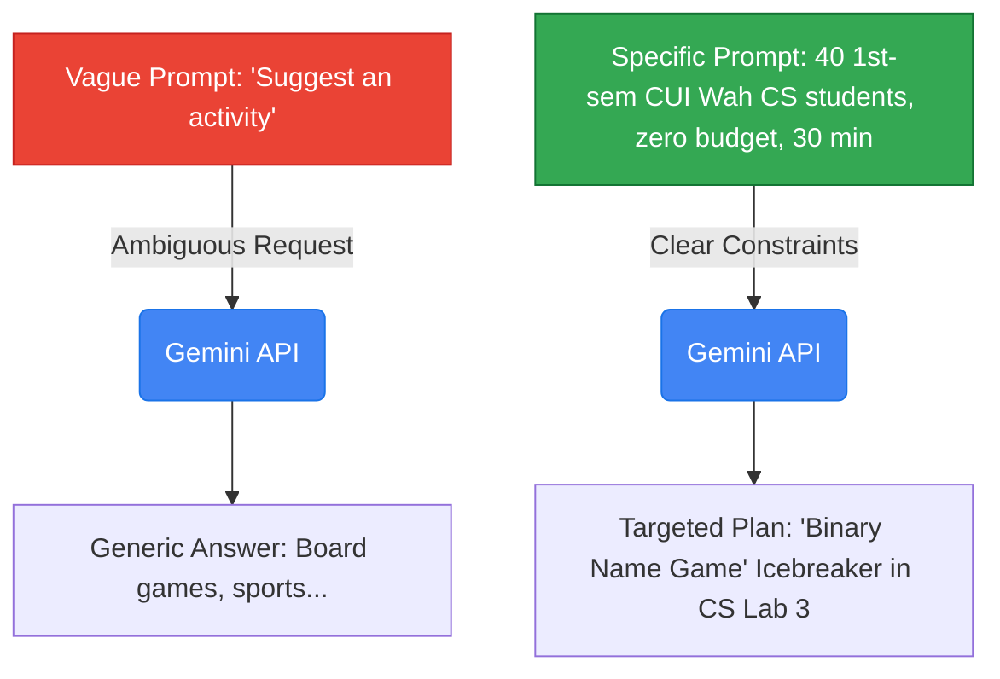
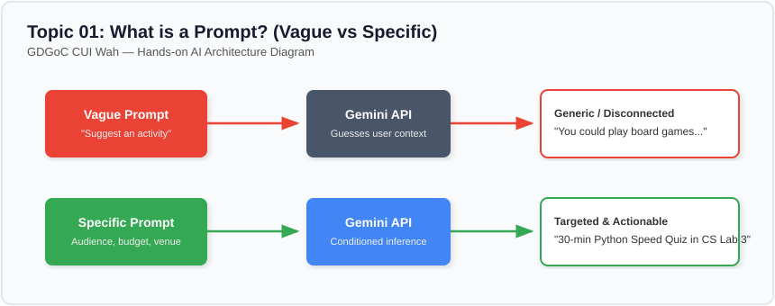

# Lesson 01: What Is a Prompt?

---

## 1. Learning Goal
By the end of this lesson, you will understand what a prompt is, how a Large Language Model (LLM) interprets your input, and why moving from vague questions to specific instructions produces vastly superior results.

---

## 2. Definition in Simple English
A **prompt** is the natural language text, question, or instruction you give to an Artificial Intelligence model to guide its response.  
Think of the AI not as an all-knowing mind that reads your thoughts, but as an advanced text-completion engine: it predicts the most likely, helpful continuation based directly on the words you provide. If your input is blurry and vague, the output will be generic and unhelpful. If your input is detailed and clear, the output will be targeted and actionable.

---

## 3. Roman Urdu Explanation
*Prompt asal mein woh sawal, hidayat ya jumla hai jo aap AI model ko dete hain taake woh aapko jawab de sake.*  
*Socho agar aap CUI Wah ki canteen mein waiter se sirf kaho: "Bhai kuch khane ko le aao!" Toh waiter pareshan ho jayega—woh chai laye, samosa laye, ya biryani? Lekin agar aap bolo: "Bhai, 50 rupay wala ek fresh chicken roll aur ek garam chai le aao," toh foran sahi cheez milegi!*  
*AI model bhi bilkul canteen ke waiter ki tarah hai. Jitna saaf aur wazeh prompt doge, utna hi zabardast aur kaam ka jawab milega.*

---

## 4. Visual Diagram

### Concept Flowchart (Mermaid)


### Standalone Architectural Diagram


---

## 5. Campus-Based Practical Example
Imagine you are an executive member of the **GDGoC CUI Wah** student society. It is the first week of the Fall semester, and 40 fresh first-year students have arrived at Academic Block 2. You need an icebreaker game before the technical session begins.
- **Weak Prompt:** `"Give me an activity for students."`  
  *(The AI might suggest a weekend camping trip or a 4-hour trivia night).*
- **Strong Prompt:** `"Suggest a 30-minute icebreaker activity for 40 first-semester Computer Science students at COMSATS Wah. The activity must cost zero budget, happen inside CS Lab 03, and help students introduce their names and favorite tech interest."`  
  *(The AI will produce a tailored, classroom-friendly game!)*

---

## 6. Real AI Experiment
In this experiment, we make two live requests to the official Gemini API using our shared helper:
1. First, we send the vague prompt and observe how the model generates a broad, unfocused answer.
2. Second, we send the specific prompt with campus constraints and observe how the model tailors its response directly to CUI Wah students.

---

## 7. Complete Runnable Python Code
You can run this demo from the repository root:
```bash
python day-1-prompt-engineering/demos/demo_01_what_is_a_prompt.py
```

```python
import sys
from pathlib import Path

# Ensure project root is accessible
REPO_ROOT = Path(__file__).resolve().parent.parent.parent
if str(REPO_ROOT) not in sys.path:
    sys.path.insert(0, str(REPO_ROOT))

from src.ai_helper import ask_gemini

# 1. Vague prompt
vague_prompt = "Suggest an activity for university students."

# 2. Specific prompt with context & constraints
specific_prompt = (
    "Suggest a 30-minute icebreaker activity for 40 first-semester "
    "Computer Science students at COMSATS University Islamabad (Wah Campus). "
    "The activity must require zero budget, work inside an academic classroom, "
    "and help students learn each other's names and coding interests."
)

print("--- [EXPERIMENT 1: VAGUE PROMPT] ---")
response_1 = ask_gemini(prompt=vague_prompt)
print(response_1.strip())

print("\n--- [EXPERIMENT 2: SPECIFIC PROMPT] ---")
response_2 = ask_gemini(prompt=specific_prompt)
print(response_2.strip())
```

---

## 8. Illustrative Sample Output
> *Illustrative output — actual Gemini responses may vary.*

```text
--- [EXPERIMENT 1: VAGUE PROMPT] ---
Here are some general activities for university students:
1. Host a movie night in the common room.
2. Form an intramural volleyball or soccer team.
3. Organize a weekend study group or cafe visit.
4. Have an outdoor picnic.

--- [EXPERIMENT 2: SPECIFIC PROMPT] ---
Activity: "Two Truths and a Bug" (30-Minute CS Icebreaker)
Venue: Academic Classroom / CS Lab 03, CUI Wah
Budget: PKR 0

How It Works:
1. Divide the 40 students into 5 pods of 8 students.
2. Each student shares their name, hometown, and three quick statements: two real facts about their hobbies and one funny programming misconception (e.g., "HTML is a programming language" or "I wrote a virus in C++").
3. Pod members guess the fake statement.
4. Each group elects one representative to share the most creative tech interest with the whole room.
```

---

## 9. What the Code Does
1. `from src.ai_helper import ask_gemini`: Imports our standardized, secure function connecting to the Google GenAI SDK.
2. Defines two Python strings: one lacking essential context, and one rich in operational constraints.
3. Calls `ask_gemini(...)` twice to transmit both queries across the internet to Google's live server.
4. Prints the model's actual responses side-by-side so students can contrast their utility.

---

## 10. Try It Yourself
Modify `specific_prompt` in `demo_01_what_is_a_prompt.py` or the notebook:
1. Change the venue to `"Central Cafeteria lawn"` and audience to `"Software Engineering students preparing for their first quiz"`.
2. Add a constraint: `"Explain the activity in bullet points using a humorous tone."`
3. Run the script again and inspect the new model output!

---

## 11. Reflection Question
Why did the AI not automatically know that you needed a classroom activity in Wah Cantt when you sent the first prompt?  
*(Hint: Think about where the model's knowledge ends and where your specific situational context begins!)*
