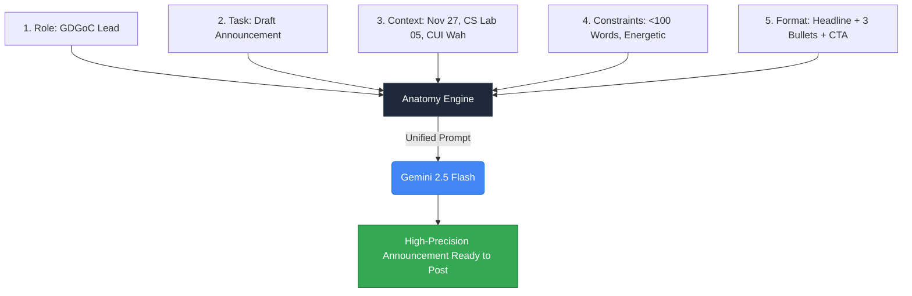
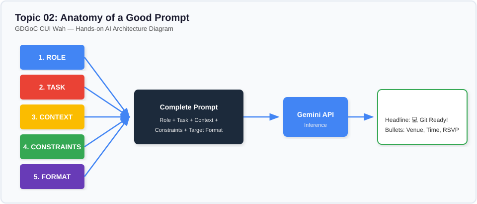

# Lesson 02: Anatomy of a Good Prompt

---

## 1. Learning Goal
By the end of this lesson, you will master the **5 Core Pillars** of prompt anatomy (**Role, Task, Context, Constraints, Output Format**) and understand how combining them turns unpredictable AI responses into reliable, production-ready outputs.

---

## 2. Definition in Simple English
Just as a human body has a skeleton that gives it structure, an effective prompt has an **anatomy** consisting of five interlocking components:
1. **Role:** Who should the AI pretend to be? *(e.g., senior developer, student mentor, technical writer)*.
2. **Task:** What exact action should the AI perform? *(e.g., draft an announcement, debug a function)*.
3. **Context:** What background details, facts, or campus environment must the AI know? *(e.g., venue, date, audience background)*.
4. **Constraints:** What boundaries, word limits, negative rules, or tone restrictions must the AI respect? *(e.g., under 100 words, no technical jargon)*.
5. **Output Format:** What visual layout, schema, or structure should the final response adopt? *(e.g., headline + 3 bullets + call to action)*.

---

## 3. Roman Urdu Explanation
*Jab hum kisi insaan se baat karte hain toh background naturally samajh aa jata hai, lekin AI ke paas apna dimagh nahi hota. Agar aap prompt ko 5 hisson mein toren ge toh model kabhi bhatkega nahi:*  
1. **Role (Kirdar):** *"Tum GDGoC CUI Wah ke energetic student lead ho."*  
2. **Task (Kaam):** *"Freshers ke liye Git workshop ka WhatsApp message likho."*  
3. **Context (Mahool/Haqeeqat):** *"Event Friday ko CS Lab 5 mein dopahar 2 baje hai. Bacha party pehli dafa code push karegi."*  
4. **Constraints (Pabandiyan):** *"100 alfaaz se zyada na ho, mushkil angrezi na ho, friendly aur purjosh tone ho."*  
5. **Output Format (Shakal):** *"Ek catchy headline, 3 bullets, aur aakhir mein registration link ki jagah."*  
*In 5 cheezon ko mila kar prompt banega toh output seedha broadcast karne ke qabil hoga!*

---

## 4. Visual Diagram

### Concept Flowchart (Mermaid)


### Standalone Architectural Diagram


---

## 5. Campus-Based Practical Example
Suppose the GDGoC team at CUI Wah wants to announce the **Git & GitHub Essentials** workshop.
- **Bare Prompt:** `"Write an announcement for a Git workshop."`  
  *(The model doesn't know where Wah campus is, when the session occurs, or whether attendees are seniors or first-semester freshers).*
- **5-Pillar Prompt:** We explicitly assemble Role + Task + Context + Constraints + Format so the model knows the exact lab (CS Lab 05), timing (Friday 2 PM), audience level (zero Git experience), and desired WhatsApp layout.

---

## 6. Real AI Experiment
In this experiment, we execute both prompts against Google Gemini:
1. First, we call the API with the bare one-liner prompt.
2. Second, we send the complete prompt containing all 5 anatomical components and compare formatting precision, tone, and accuracy.

---

## 7. Complete Runnable Python Code
Run this demonstration from the repository root:
```bash
python day-1-prompt-engineering/demos/demo_02_anatomy_of_a_good_prompt.py
```

```python
import sys
from pathlib import Path

REPO_ROOT = Path(__file__).resolve().parent.parent.parent
if str(REPO_ROOT) not in sys.path:
    sys.path.insert(0, str(REPO_ROOT))

from src.ai_helper import ask_gemini

# 1. Bare Prompt
bare_prompt = "Write an announcement for a Git workshop."

# 2. Anatomically Complete Prompt (5 Pillars)
role = "Role: You are the Lead Community Organizer for GDGoC CUI Wah."
task = "Task: Write an energetic WhatsApp announcement for a beginner workshop."
context = (
    "Context: The event is 'Git & GitHub Essentials for 1st-Sem Devs'. "
    "Venue: CS Lab 05, CUI Wah. Date: Friday, Nov 27 at 2:00 PM. "
    "Audience: Freshers who have never pushed code before."
)
constraints = (
    "Constraints: Maximum 100 words. Keep tone friendly and encouraging. "
    "Include 3 key takeaway bullet points. Do not use corporate jargon."
)
output_format = (
    "Format:\n"
    "[Punchy Headline with Emojis]\n"
    "[1-sentence Welcome Hook]\n"
    "Key Details:\n"
    "- When & Where\n"
    "- What You'll Learn (3 bullets)\n"
    "[Call to Action & Registration Link placeholder]"
)

anatomy_prompt = f"{role}\n{task}\n{context}\n{constraints}\n{output_format}"

print("--- [EXPERIMENT 1: BARE PROMPT] ---")
print(ask_gemini(bare_prompt).strip())

print("\n--- [EXPERIMENT 2: 5-PILLAR PROMPT] ---")
print(ask_gemini(anatomy_prompt).strip())
```

---

## 8. Illustrative Sample Output
> *Illustrative output — actual Gemini responses may vary.*

```text
--- [EXPERIMENT 1: BARE PROMPT] ---
Join us for our upcoming Git Workshop! Learn the fundamentals of version control, branches, and commits. This workshop is ideal for software developers looking to improve their workflow. Date and venue to be determined. Register today!

--- [EXPERIMENT 2: 5-PILLAR PROMPT] ---
🚀 Level Up Your Code with Git & GitHub! 💻

Hey Freshers! Ready to stop losing your code and start collaborating like real software engineers?

📍 Key Details:
• When & Where: Friday, Nov 27 @ 2:00 PM | CS Lab 05, CUI Wah

What You'll Learn:
• What Git actually is (and why it saves your GPA)
• How to commit and push your very first repository
• How to collaborate on team projects without panic

Seats in Lab 05 are limited! Register now: [Link Here] 🔗
```

---

## 9. What the Code Does
1. Deconstructs the prompt into five distinct, labeled Python variables (`role`, `task`, `context`, `constraints`, `output_format`).
2. Concatenates these variables into a single unified prompt string using standard Python f-strings.
3. Sends both the bare and complete strings to Gemini using `ask_gemini(...)`.
4. Outputs the live AI generations for direct side-by-side comparison.

---

## 10. Try It Yourself
1. Open `demo_02_anatomy_of_a_good_prompt.py`.
2. Swap the workshop topic from Git to **"Web Development Sprint: Building Your First HTML/CSS Portfolio"**.
3. Update the venue to **"Seminar Room B"** and change the constraint to: `"Include one funny line about forgetting a semicolon"`.
4. Run the code and check if the AI followed all 5 pillars!

---

## 11. Reflection Question
Which of the 5 pillars has the highest impact if your output is too lengthy or off-topic? How does adding constraints prevent AI rambling?
