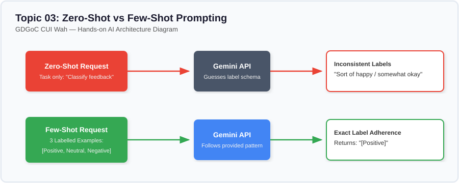

# Lesson 03: Zero-Shot and Few-Shot Prompting

---

## 1. Learning Goal
By the end of this lesson, you will understand the difference between **Zero-Shot** and **Few-Shot** prompting, how providing examples (*in-context learning*) conditions the model's behavior, and how to reliably classify campus messages without fine-tuning.

---

## 2. Definition in Simple English
- **Zero-Shot Prompting:** You provide only the task instruction to the AI model without giving any solved examples. The model relies solely on its pre-existing training to guess the desired output format and classification rules.
- **Few-Shot Prompting:** You provide a small number of input-output demonstration pairs (*shots*) before presenting the real test input. The model recognizes the visual and structural pattern and reproduces it with extreme precision.

---

## 3. Roman Urdu Explanation
*Zero-Shot aur Few-Shot prompting ko aam alfaaz mein aise samjhein:*  
*Agar teacher class mein aaye aur achanak bole: "Chalo bacho, ek technical summary likho!" aur koi example na de—toh har student apne hisab se ajeeb o ghareeb tareeqe se likhega (yeh hai Zero-Shot).*  
*Lekin agar teacher board par 2 ya 3 solved misalein (examples) likh de ke "Dekho, pehle headline ayegi, phir 2 bullets, aur aakhir mein conclusion"—toh saari class bilkul usi pattern ko follow karegi (yeh hai Few-Shot!)*  
*AI model ke samne bhi jab aap 2 ya 3 misalein rakh dete hain, toh woh confuse hue baghair theek wahi pattern pakad leta hai.*

---

## 4. Visual Diagram

### Concept Flowchart (Mermaid)
```mermaid
graph TD
    subgraph Zero-Shot
        A1[Instruction Alone: 'Classify feedback'] --> B1(Gemini API)
        B1 --> C1[Inconsistent Output: 'Pretty happy / ok']
    end

    subgraph Few-Shot
        A2[Instruction + 3 Labelled Examples] --> B2(Gemini API)
        B2 --> C2[Precise Output: '[SPONSORSHIP]']
    end

    style A1 fill:#EA4335,stroke:#c5221f,color:#fff
    style A2 fill:#34A853,stroke:#137333,color:#fff
    style B1 fill:#4285F4,stroke:#1a73e8,color:#fff
    style B2 fill:#4285F4,stroke:#1a73e8,color:#fff
```

### Standalone Architectural Diagram


---

## 5. Campus-Based Practical Example
Suppose your **GDGoC CUI Wah** management team receives dozens of WhatsApp queries every day about the upcoming SpeedCode Hackathon. You want an automated assistant to sort messages into categories:
1. `[REGISTRATION]`
2. `[VENUE_INQUIRY]`
3. `[SPONSORSHIP]`

- If you just say `"Classify this message: Can our software house set up a branded booth?"` without examples (Zero-shot), the model might write two paragraphs explaining marketing strategies!
- If you supply 3 clear examples showing `Message -> [CATEGORY]` (Few-shot), the model instantly returns `[SPONSORSHIP]` cleanly and predictably.

---

## 6. Real AI Experiment
In this experiment, we keep the test message completely identical:
`"Salam! Can a local software house set up a branded booth at the hackathon?"`  
1. In the **Zero-Shot** call, we only give category names.
2. In the **Few-Shot** call, we include 3 labeled examples of student queries.  
We inspect whether the model adheres strictly to the bracketed label formatting.

---

## 7. Complete Runnable Python Code
Run this demonstration from the repository root:
```bash
python day-1-prompt-engineering/demos/demo_03_zero_shot_and_few_shot.py
```

```python
import sys
from pathlib import Path

REPO_ROOT = Path(__file__).resolve().parent.parent.parent
if str(REPO_ROOT) not in sys.path:
    sys.path.insert(0, str(REPO_ROOT))

from src.ai_helper import ask_gemini

test_message = "Salam! Can a local software house set up a branded booth at the hackathon?"

# 1. Zero-Shot Prompt
zero_shot_prompt = (
    "Classify the following student club message into exactly one category.\n"
    "Categories: REGISTRATION, VENUE_INQUIRY, SPONSORSHIP.\n"
    f"Message: \"{test_message}\"\n"
    "Category:"
)

# 2. Few-Shot Prompt (Task + 3 Demonstrations)
few_shot_prompt = (
    "Classify the following student club messages into exactly one category.\n"
    "Allowed Categories: [REGISTRATION], [VENUE_INQUIRY], [SPONSORSHIP].\n\n"
    "Example 1:\n"
    "Message: \"Is CS Lab 03 on the ground floor or 2nd floor of Block 2?\"\n"
    "Category: [VENUE_INQUIRY]\n\n"
    "Example 2:\n"
    "Message: \"I filled the Google Form for the Python workshop but didn't get an email yet.\"\n"
    "Category: [REGISTRATION]\n\n"
    "Example 3:\n"
    "Message: \"Our tech agency wants to provide PKR 30,000 for energy drinks in exchange for logo placement.\"\n"
    "Category: [SPONSORSHIP]\n\n"
    "Now classify this new message:\n"
    f"Message: \"{test_message}\"\n"
    "Category:"
)

print("--- [EXPERIMENT 1: ZERO-SHOT] ---")
print(ask_gemini(prompt=zero_shot_prompt, temperature=0.2).strip())

print("\n--- [EXPERIMENT 2: FEW-SHOT] ---")
print(ask_gemini(prompt=few_shot_prompt, temperature=0.2).strip())
```

---

## 8. Illustrative Sample Output
> *Illustrative output — actual Gemini responses may vary.*

```text
--- [EXPERIMENT 1: ZERO-SHOT] ---
The message falls under the category of SPONSORSHIP because the software house is asking about marketing presence.

--- [EXPERIMENT 2: FEW-SHOT] ---
[SPONSORSHIP]
```

---

## 9. What the Code Does
1. Sets a low temperature (`temperature=0.2`) to encourage deterministic, focused classification.
2. Submits the test message twice: once bare, and once preceded by 3 structured demonstrations.
3. Shows how few-shot examples suppress conversational preamble and force the model to mirror your exact syntax `[LABEL]`.

---

## 10. Try It Yourself
1. Open `demo_03_zero_shot_and_few_shot.py`.
2. Change the incoming query to: `"Is there an entry ticket fee for attending the guest speaker talk?"`
3. Add a fourth category: `[TICKET_FEE]` with an example.
4. Run the script and observe if the model accurately routes the new question!

---

## 11. Reflection Question
Why is Few-Shot prompting often preferred over training a custom machine learning model for simple campus classification tasks?  
*(Hint: Think about time, data size, and developer effort!)*
