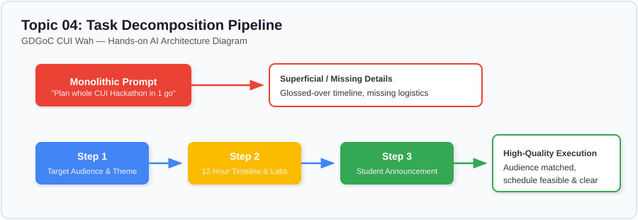

# Lesson 04: Breaking a Task into Smaller Instructions (Task Decomposition)

---

## 1. Learning Goal
By the end of this lesson, you will understand how to break complex, open-ended campus tasks into sequential sub-instructions, why chaining focused steps often produces more reliable results than one massive prompt, and how to evaluate the trade-offs of task decomposition.

---

## 2. Definition in Simple English
**Task Decomposition** is the process of taking a large, multifaceted goal and breaking it down into smaller, self-contained sub-tasks.  
When an LLM receives a massive "monolithic" prompt asking for research, planning, scheduling, and copywriting all in one breath, its attention is divided across too many simultaneous objectives. By decomposing the workflow into sequential steps—where each step's output feeds into the next prompt—you gain granular control, verify intermediate progress, and ensure every detail meets your standards.

---

## 3. Roman Urdu Explanation
*Socho aapko CUI Wah mein poora 12-ghante ka Hackathon plan karna hai. Agar aap achanak GDGoC ke team member se bolo: "Bhai, foran hackathon ka concept bhi socho, room booking bhi karao, schedule bhi banao aur WhatsApp poster bhi likh do!"—toh woh dhang se koi ek kaam bhi nahi kar sakega.*  
*Lekin agar aap step-by-step chalo:*  
1. *Pehle sirf Target Audience aur theme decide karo.*  
2. *Phir labs (CS Lab 01 & 02) ka schedule banao.*  
3. *Aakhir mein schedule dekh kar WhatsApp announcement likho.*  
*AI ke sath bhi bilkul yahi hota hai: jab aap mushkil kaam ko chote chote hisson mein baant te hain, toh har step par quality barqarar rehti hai!*

---

## 4. Visual Diagram

### Concept Flowchart (Mermaid)

```mermaid
graph TD
    subgraph Monolithic [Monolithic Prompt]
        M1[Plan entire CUI Hackathon in 1 shot] --> M2(Gemini API)
        M2 --> M3[Superficial / Rushed Plan]
    end

    subgraph Decomposed [Decomposed Pipeline]
        D1[Step 1: Audience & Objectives] --> R1(Gemini)
        R1 --> D2[Step 2: 12-Hour Lab Schedule]
        D2 --> R2(Gemini)
        R2 --> D3[Step 3: Student Broadcast]
        D3 --> R3(Gemini)
        R3 --> D4[High-Quality, Verified Plan]
    end

    style M1 fill:#EA4335,stroke:#c5221f,color:#fff
    style D1 fill:#4285F4,stroke:#1a73e8,color:#fff
    style D2 fill:#FBBC05,stroke:#f29900,color:#1a1a2e
    style D3 fill:#34A853,stroke:#137333,color:#fff
```


### Standalone Architectural Diagram


---

## 5. Campus-Based Practical Example
Suppose your student chapter is organizing the **SpeedCode Wah Hackathon**.
- **Monolithic Attempt:** `"Plan everything for SpeedCode Wah, including goals, rules, food, schedule, and social media text."`  
  *(The model will produce a long, generic essay with unrealistic timelines and generic rules).*
- **Decomposed Approach:**
  - **Step 1:** Define 3 concrete technical goals and the target semester.
  - **Step 2:** Build a 4-milestone timeline fitting CUI Wah lab timings (morning sprint, mentor check at 3 PM, final demos at 6 PM).
  - **Step 3:** Generate the concise student announcement based on the confirmed schedule.

---

## 6. Real AI Experiment
In this experiment, we execute:
1. One single monolithic prompt asking Gemini for everything at once.
2. A 3-step chained Python pipeline where the output of Step 1 informs Step 2, and Step 2 informs Step 3.  
We compare the clarity, depth, and practical feasibility of both outcomes.

---

## 7. Complete Runnable Python Code
Run this demonstration from the repository root:
```bash
python day-1-prompt-engineering/demos/demo_04_task_decomposition.py
```

```python
import sys
from pathlib import Path

REPO_ROOT = Path(__file__).resolve().parent.parent.parent
if str(REPO_ROOT) not in sys.path:
    sys.path.insert(0, str(REPO_ROOT))

from src.ai_helper import ask_gemini

# 1. Monolithic Request
mono_prompt = (
    "Plan a full-day coding hackathon for COMSATS University Wah. "
    "Include the audience, learning goals, hour-by-hour schedule, and an announcement."
)
print("--- [EXPERIMENT 1: MONOLITHIC CALL] ---")
print(ask_gemini(mono_prompt)[:400] + "\n...[truncated]...")

# 2. Decomposed Pipeline
print("\n--- [EXPERIMENT 2: STEP 1 - AUDIENCE & GOALS] ---")
step1_prompt = (
    "Define 3 specific learning objectives and the exact target audience "
    "for a 1-day beginner coding hackathon called 'SpeedCode Wah'. Max 80 words."
)
step1_res = ask_gemini(step1_prompt)
print(step1_res.strip())

print("\n--- [EXPERIMENT 2: STEP 2 - SCHEDULE IN CS LABS] ---")
step2_prompt = (
    f"Based on these objectives:\n\"{step1_res.strip()}\"\n"
    "Draft a 4-milestone timeline for CS Lab 01 at CUI Wah (Kickoff, Sprint, Review, Pitches)."
)
step2_res = ask_gemini(step2_prompt)
print(step2_res.strip())

print("\n--- [EXPERIMENT 2: STEP 3 - ANNOUNCEMENT] ---")
step3_prompt = (
    f"Using this schedule:\n\"{step2_res.strip()}\"\n"
    "Write a 50-word student broadcast inviting teams of 3 to register."
)
step3_res = ask_gemini(step3_prompt)
print(step3_res.strip())
```

---

## 8. Illustrative Sample Output
> *Illustrative output — actual Gemini responses may vary.*

```text
--- [EXPERIMENT 1: MONOLITHIC CALL] ---
Hackathon Plan: Start at 8 AM. Form teams. Code until 5 PM. Have lunch somewhere. Judges pick winner. Announcement: Come to the hackathon today!

--- [EXPERIMENT 2: STEP 1 - AUDIENCE & GOALS] ---
Target Audience: 1st and 2nd semester CS/SE/AI undergraduate students at CUI Wah.
Objectives:
1. Build confidence working in collaborative teams of 3.
2. Apply introductory Python and logic building to real-world problems.
3. Learn basic project pitching and presentation skills before faculty judges.

--- [EXPERIMENT 2: STEP 2 - SCHEDULE IN CS LABS] ---
Venue: CS Lab 01 & 02, Academic Block 2, CUI Wah
• 08:30 AM - 09:30 AM: Problem Statement Release & Team Check-in
• 09:30 AM - 01:00 PM: Deep Coding Sprint (Mentors on site)
• 01:00 PM - 02:00 PM: Lunch & Prayer Break
• 02:00 PM - 05:00 PM: MVP Polish & Final Submission
• 05:30 PM - 07:00 PM: 3-Minute Team Pitches & Award Ceremony

--- [EXPERIMENT 2: STEP 3 - ANNOUNCEMENT] ---
🚀 Ready for the ultimate coding sprint? GDGoC CUI Wah presents SpeedCode 2026! 
Join us at CS Lab 01 on Nov 20 from 8:30 AM to 7 PM. Form your squad of 3, build real projects, and pitch to industry judges! 
Limited seats available. Register your team now! 🔗
```

---

## 9. What the Code Does
1. Demonstrates the difference between asking everything in one query versus sequentially feeding validated outputs.
2. Chains outputs together using Python f-strings: `step1_res` is embedded into `step2_prompt`, and `step2_res` is embedded into `step3_prompt`.
3. Demonstrates that each subtask remains concise, focused, and directly inspectable by a human developer.

---

## 10. Try It Yourself
Exercise: Break down the task **"Prepare for my first C++ programming quiz on loops and arrays at CUI Wah"** into 3 manageable prompt steps:
- Step 1: Generate a concept summary with common pitfalls.
- Step 2: Generate 3 practice problems of progressive difficulty.
- Step 3: Generate a 1-page quick revision checklist.

---

## 11. Reflection Question
Does breaking tasks down *always* guarantee a better result? What are the trade-offs in terms of API cost, latency, and code complexity?
