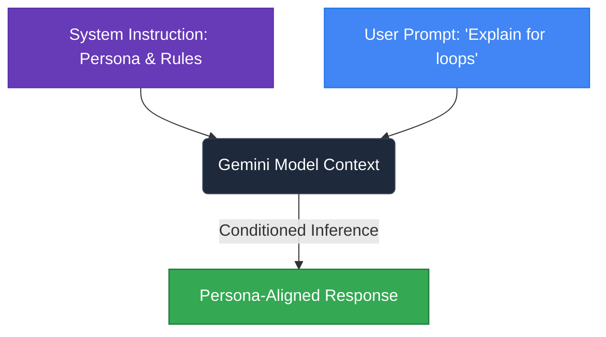
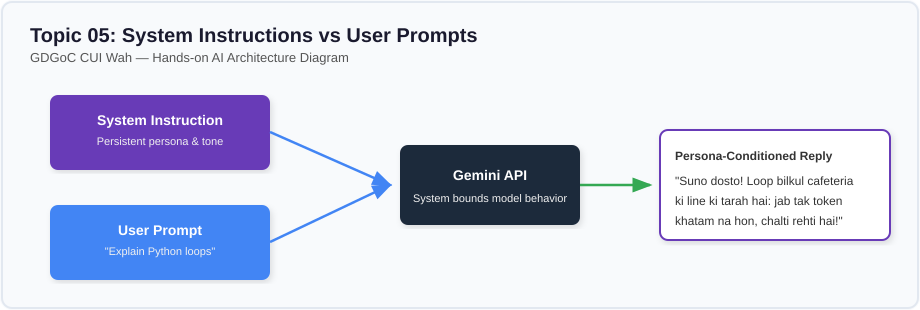

# Lesson 05: System Instructions vs User Prompts

---

## 1. Learning Goal
By the end of this lesson, you will understand the technical and practical distinction between **System Instructions** and **User Prompts**, how Google's `google-genai` SDK configures system-level behavior, and how persona conditioning shapes an AI's tone, voice, and boundaries.

---

## 2. Definition in Simple English
In modern Large Language Models:
- **System Instruction:** A high-level, persistent behavioral guide that tells the model *how to behave, who to be, and what rules to always obey*. It sets the persona, tone, language constraints, and ethical guardrails.
- **User Prompt:** The immediate, dynamic query or message sent by the end-user *during a specific interaction*.

While a user might ask anything, the system instruction ensures the AI responds according to predefined developer policies and tone.

---

## 3. Roman Urdu Explanation
*System Instruction aur User Prompt ke farq ko CUI Wah ke classroom se samjhein:*  
*Aap class mein baith kar teacher se sawal puchte hain: "Sir, for loop kya hota hai?" (Yeh hai User Prompt).*  
*Lekin teacher ka dimagh pehle se set hai ke "Main aik strict professor hoon aur mujhe formal urdu/english mein 2 jumlon mein jawab dena hai," ya phir unka mood friendly senior jaisa hai jo canteen ki chai ki misaal de kar samjhate hain.*  
*Jo rules aur persona pehle se tay hota hai, use **System Instruction** kehte hain. Sawal jo marzi aaye, AI usi rang dhang mein jawab dega jo system ne fix kiya hai!*

---

## 4. Visual Diagram

### Concept Flowchart (Mermaid)


### Standalone Architectural Diagram


---

## 5. Campus-Based Practical Example
Suppose GDGoC CUI Wah wants to build an AI study assistant for first-semester students:
- If a user sends: `"Explain what an array index is"`,
  - With a **System Instruction of a Strict Professor**, the AI gives an academic memory-offset definition.
  - With a **System Instruction of a Senior Student Mentor**, the AI explains it using the locker numbers in Academic Block 2 in conversational Roman Urdu!

---

## 6. Real AI Experiment
In this experiment, we keep the user message completely identical:
`"Explain what a Python 'for' loop is and when to use it."`  
We call the Gemini API twice using the official `types.GenerateContentConfig(system_instruction=...)`:
1. First with the persona of a **Strict Academic CS Professor**.
2. Second with the persona of a **Friendly Roman Urdu Student Mentor at CUI Wah**.

---

## 7. Complete Runnable Python Code
Run this demonstration from the repository root:
```bash
python day-1-prompt-engineering/demos/demo_05_system_vs_user_instructions.py
```

```python
import sys
from pathlib import Path

REPO_ROOT = Path(__file__).resolve().parent.parent.parent
if str(REPO_ROOT) not in sys.path:
    sys.path.insert(0, str(REPO_ROOT))

from src.ai_helper import ask_gemini

# Constant user query
user_message = "Explain what a Python 'for' loop is and when to use it."

# Persona 1: Strict Academic Professor
system_professor = (
    "You are a rigorous Computer Science professor at an accredited university. "
    "Provide an academically precise, formal explanation in exactly two sentences. "
    "No conversational filler or greetings."
)

# Persona 2: Friendly Roman Urdu Senior Student
system_urdu_mentor = (
    "Aap COMSATS University Wah ke senior student mentor ho. "
    "First-semester juniors ko bohot friendly andaaz mein Roman Urdu mein samjhao. "
    "CUI Wah ki canteen ya campus life ki relatable misaal do."
)

print("--- [EXPERIMENT 1: PROFESSOR SYSTEM INSTRUCTION] ---")
print(ask_gemini(prompt=user_message, system_instruction=system_professor))

print("\n--- [EXPERIMENT 2: ROMAN URDU MENTOR SYSTEM INSTRUCTION] ---")
print(ask_gemini(prompt=user_message, system_instruction=system_urdu_mentor))
```

---

## 8. Illustrative Sample Output
> *Illustrative output — actual Gemini responses may vary.*

```text
--- [EXPERIMENT 1: PROFESSOR SYSTEM INSTRUCTION] ---
A Python 'for' loop is an iterator-based control flow statement that sequentially executes a code block across elements of an iterable sequence. It is utilized when the number of iterations or the collection bounds are deterministically defined prior to execution.

--- [EXPERIMENT 2: ROMAN URDU MENTOR SYSTEM INSTRUCTION] ---
Suno juniors! 'For loop' bilkul CUI Wah ki central canteen ki samosa counter line ki tarah hai. Jab tak counter par 10 bache khare hain, loop har bache ko baari baari samosa de kar aage barhta jayega. Jab pehle se pata ho ke kitni cheezon par baari baari kaam karna hai—jaise 5 subjects ke marks calculate karna—toh hamesha 'for loop' lagao!
```

---

## 9. What the Code Does
1. Uses `src/ai_helper.py`, which maps `system_instruction` directly to `google.genai.types.GenerateContentConfig(system_instruction=...)`.
2. Sends the system instruction in the dedicated configuration payload rather than concatenating it into user text.
3. Contrasts the formal academic output against the colloquial, localized Roman Urdu response.

---

## 10. Try It Yourself
Exercise: Design a system instruction for an **"AI Code Reviewer"**:
1. It must only inspect Python code.
2. It must give feedback in 3 sections: `[Clean Code]`, `[Potential Bug]`, and `[Speed Improvement]`.
3. It must refuse to write full homework assignments for students.
Test it by passing a small 5-line Python script as the user prompt!

---

## 11. Reflection Question
Why is configuring a `system_instruction` via API parameters safer than just prepending `"Act like a professor..."` into the user prompt string?  
*(Hint: Think about what happens if an untrusted user tries to tell the model to ignore earlier instructions!)*
