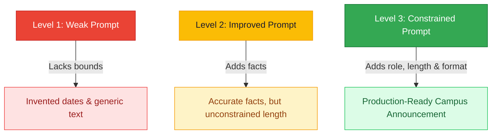
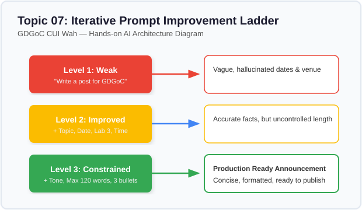

# Lesson 07: Prompt Improvement (Weak vs Improved vs Constrained)

---

## 1. Learning Goal
By the end of this lesson, you will master the iterative process of prompt refinement, learn how adding concrete campus constraints eliminates AI hallucinations, and understand why a well-engineered prompt significantly increases reliability while still requiring human verification.

---

## 2. Definition in Simple English
Prompt engineering is not a one-time guess; it is an **iterative engineering cycle**.  
Prompts naturally evolve across three distinct tiers of quality:
1. **Weak / Vague:** Minimal words, no context, no bounds. The model is forced to invent facts, dates, and tones.
2. **Improved / Descriptive:** Includes real facts and context, but lacks output formatting and length boundaries. The output is accurate but often overly verbose.
3. **Carefully Constrained:** Combines verified facts, explicit roles, word-count ceilings, and structural guidelines.

> [!IMPORTANT]
> A better prompt dramatically increases the probability of an accurate answer, but it **never guarantees 100% perfection**. Critical outputs must always be inspected.

---

## 3. Roman Urdu Explanation
*Koi bhi developer pehli baar mein perfect prompt nahi likh sakta. Prompt ko behtar banana ek tarteeb-war safar hai:*  
- *Pehli koshish (Weak): "GDGoC ke liye post likho." (Model apni marzi se dates aur venue imagine kar lega).*  
- *Doosri koshish (Improved): "GDGoC CUI Wah ke Python workshop ke liye post likho jo Nov 5 ko Lab 3 mein hai." (Ab haqeeqat theek hai, lekin shayad 400 alfaaz ka essay likh de).*  
- *Teesri koshish (Constrained): "Role: Social media lead. 80 alfaaz ka WhatsApp post. 3 bullet points, Lab 3, free entry, aur registration link placeholder." (Ab output bilkul ready-to-use hoga!)*  
*Har iteration mein aap model ki bhatakne ki gunjaish ko kam karte hain.*

---

## 4. Visual Diagram

### Concept Flowchart (Mermaid)


### Standalone Architectural Diagram


---

## 5. Campus-Based Practical Example
Suppose GDGoC CUI Wah wants to announce the **Python for Absolute Beginners** workshop on LinkedIn.
- If you prompt: `"Write a post for GDGoC"`, the AI might say: *"Join us at Google Headquarters in California this weekend!"*  
- If you supply verified campus facts (CS Lab 03, Academic Block 2, CUI Wah, Nov 5), the AI anchors itself to reality.
- If you enforce word limits (70–100 words) and structure (3 bullets + CTA), the post is ready to publish without 15 minutes of manual re-editing!

---

## 6. Real AI Experiment
In this experiment, we execute two separate API calls against Gemini:
1. First, we send the weak prompt: `"Write a post for GDGoC."`
2. Second, we send the constrained prompt containing verified facts and formatting rules.  
We display both actual returned texts side-by-side.

---

## 7. Complete Runnable Python Code
Run this demonstration from the repository root:
```bash
python day-1-prompt-engineering/demos/demo_07_prompt_improvement.py
```

```python
import sys
from pathlib import Path

REPO_ROOT = Path(__file__).resolve().parent.parent.parent
if str(REPO_ROOT) not in sys.path:
    sys.path.insert(0, str(REPO_ROOT))

from src.ai_helper import ask_gemini

# 1. Weak Prompt
weak_prompt = "Write a post for GDGoC."

# 2. Constrained Prompt
improved_prompt = (
    "You are the Social Media Lead for GDGoC CUI Wah. "
    "Write a concise, high-energy LinkedIn announcement for an upcoming workshop.\n\n"
    "Verified Facts:\n"
    "- Event: 'Python for Absolute Beginners'\n"
    "- Date: Thursday, Nov 05, 2026\n"
    "- Time: 10:00 AM - 01:00 PM\n"
    "- Venue: CS Lab 03, Academic Block 2, CUI Wah\n"
    "- Audience: 1st semester students with zero coding experience\n"
    "- Fee: Free\n\n"
    "Strict Constraints:\n"
    "1. Exactly between 70 and 100 words.\n"
    "2. Include 3 emoji bullet points highlighting what students will build.\n"
    "3. Include a clear call to action with a registration link placeholder.\n"
    "4. Tone: Welcoming, professional, yet student-friendly."
)

print("--- [EXPERIMENT 1: WEAK PROMPT] ---")
print(ask_gemini(weak_prompt).strip())

print("\n--- [EXPERIMENT 2: CONSTRAINED PROMPT] ---")
print(ask_gemini(improved_prompt).strip())
```

---

## 8. Illustrative Sample Output
> *Illustrative output — actual Gemini responses may vary.*

```text
--- [EXPERIMENT 1: WEAK PROMPT] ---
Excited to announce our next GDG meetup! We will explore cutting-edge web development and cloud technologies. Connect with tech innovators, network with Google engineers, and enjoy complimentary pizza. RSVP now!

--- [EXPERIMENT 2: CONSTRAINED PROMPT] ---
🚀 Ready to write your first line of Python? 

GDGoC CUI Wah invites all 1st-semester students to our hands-on "Python for Absolute Beginners" workshop! No prior coding experience required.

Here is what you will create:
🐍 Interactive logic games from scratch
⚡ Automated scripts for campus tasks
💡 Core problem-solving muscle for semester quizzes

📅 Thursday, Nov 05, 2026 | 10:00 AM - 1:00 PM
📍 CS Lab 03, Academic Block 2, CUI Wah
🎟️ Free entry! Limited lab seats.

Register now: [https://cuiwah.gdgoc.example/register-python] 🔗
```

---

## 9. What the Code Does
1. Submits both prompts independently to the live Gemini API.
2. Demonstrates that without constraints, the model hallucinates fictional venues and audiences.
3. Proves that providing clear ground facts and formatting bounds guides the LLM to deliver clean, professional copy.

---

## 10. Try It Yourself
Exercise: Take this weak prompt:
> *"Help me study for programming."*  

Rewrite it into a **Tier 3 Constrained Prompt** specifying:
- Course: Programming Fundamentals (CSC101) at CUI Wah.
- Topic: While loops and Sentinel values.
- Desired output: 2 common bug examples, 1 practice challenge, and a 3-bullet revision rule.
- Word count: Under 120 words.

---

## 11. Reflection Question
Why is human review still essential even after writing a Tier 3 constrained prompt? Can an AI still make subtle logical errors within a constrained format?
