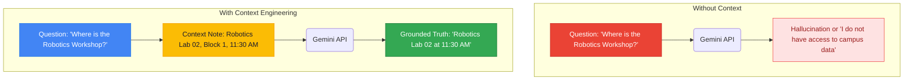
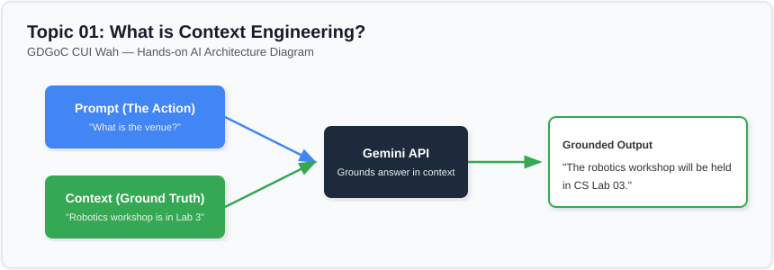

# Lesson 01: What Is Context Engineering?

---

## 1. Learning Goal
By the end of this lesson, you will understand the foundational concept of **Context Engineering**, how it differs from Prompt Engineering, and why providing the model with verified factual context prevents hallucinations and grounds answers in truth.

---

## 2. Definition in Simple English
A **prompt** tells the model *what action to take* (e.g., summarize, extract, answer).  
**Context** provides the *supporting facts, data, documents, or environment* that the model must use while performing that action.  
**Context Engineering** is the practice of systematically gathering, filtering, structuring, and passing the exact right information into the model's context window so its answer is truthful, relevant, and grounded in your private data.

---

## 3. Roman Urdu Explanation
*Prompt Engineering aur Context Engineering ka aasan farq yeh hai:*  
- *Prompt AI ko batata hai ke **karna kya hai**.*  
- *Context AI ko batata hai ke **kin baton/facts ko dekh kar karna hai**.*  
*Socho agar aap kisi dost se pucho: "CUI Wah mein kal test kis time hai?" Agar dost ke paas date sheet na ho, toh woh ya toh andaza lagayega ya galat time bata dega.*  
*Lekin agar aap date sheet ka kagaz uske hath mein pakda kar pucho: "Yeh lo date sheet, isko dekh kar batao test kab hai?"—toh woh 100% sahi time batayega!*  
*Woh date sheet ka kagaz hi asal mein **Context** hai.*

---

## 4. Visual Diagram

### Concept Flowchart (Mermaid)


### Standalone Architectural Diagram


---

## 5. Campus-Based Practical Example
Suppose CUI Wah is hosting a brand-new, fictional **AI Robotics Workshop** on November 18, 2026.
Because this event was scheduled today and is completely fictional, it was never part of Google Gemini's pre-training internet corpus.
- If you ask Gemini: `"Where is the robotics workshop at CUI Wah?"` without context, Gemini has no way to know! It will either guess an imaginary room or apologize.
- But if your application fetches the official campus memo and injects it into the prompt, Gemini reads the memo and gives the student the exact room (Robotics Lab 02) and time (11:30 AM)!

---

## 6. Real AI Experiment
In this experiment, we execute two separate live calls:
1. First, we send the raw student question without any context.
2. Second, we inject a fictional campus memo into the prompt and instruct the model to ground its answer strictly in that notice.

---

## 7. Complete Runnable Python Code
Run this demonstration from the repository root:
```bash
python day-2-context-engineering/demos/demo_01_what_is_context_engineering.py
```

```python
import sys
from pathlib import Path

REPO_ROOT = Path(__file__).resolve().parent.parent.parent
if str(REPO_ROOT) not in sys.path:
    sys.path.insert(0, str(REPO_ROOT))

from src.ai_helper import ask_gemini

question = "Where and at what time is the AI Robotics Workshop happening at CUI Wah?"

context_note = (
    "CAMPUS NOTICE (FICTIONAL TEACHING DATA):\n"
    "Event: Hands-on AI Robotics Workshop\n"
    "Date: November 18, 2026\n"
    "Time: 11:30 AM - 02:00 PM\n"
    "Venue: Electrical & Robotics Lab 02, Ground Floor, Academic Block 1, CUI Wah\n"
    "Instructor: Engr. Daniyal Khan\n"
)

# 1. Without Context
print("--- [EXPERIMENT 1: NO CONTEXT] ---")
print(ask_gemini(prompt=question).strip())

# 2. With Grounded Context
augmented_prompt = (
    f"Use ONLY the following campus notice to answer the student's question.\n"
    f"If the answer is not in the notice, say 'Information unavailable'.\n\n"
    f"Notice:\n{context_note}\n\n"
    f"Question: {question}"
)

print("\n--- [EXPERIMENT 2: WITH CONTEXT] ---")
print(ask_gemini(prompt=augmented_prompt).strip())
```

---

## 8. Illustrative Sample Output
> *Illustrative output — actual Gemini responses may vary.*

```text
--- [EXPERIMENT 1: NO CONTEXT] ---
I do not have access to specific real-time scheduling information for COMSATS University Islamabad, Wah Campus. Please check your official student portal or contact the departmental coordinator for workshop details.

--- [EXPERIMENT 2: WITH CONTEXT] ---
The Hands-on AI Robotics Workshop is scheduled for November 18, 2026, from 11:30 AM to 02:00 PM in Electrical & Robotics Lab 02, located on the Ground Floor of Academic Block 1 at CUI Wah.
```

---

## 9. What the Code Does
1. Demonstrates the knowledge boundary of foundation models: they know general Python and world history, but they do *not* know your private campus schedules.
2. Uses string interpolation to prepend the factual document before the student's query.
3. Implements the foundational pattern of **Retrieval-Augmented Generation (RAG)**: *Context + Question -> Grounded Generation*.

---

## 10. Try It Yourself
Exercise: Add a new detail to `context_note`:
`"Lunch tokens will be distributed in the courtyard at 1:00 PM."`  
Change the question to: `"When and where do we get lunch?"`  
Run the code and verify that Gemini extracts the new fact accurately!

---

## 11. Reflection Question
Why is context engineering considered more practical for university applications than retraining or fine-tuning the entire AI model every time a workshop date changes?
