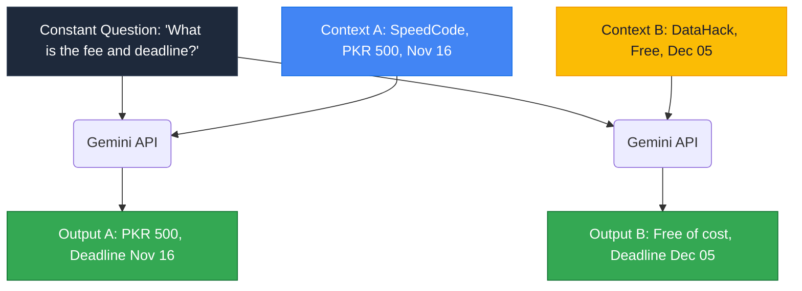
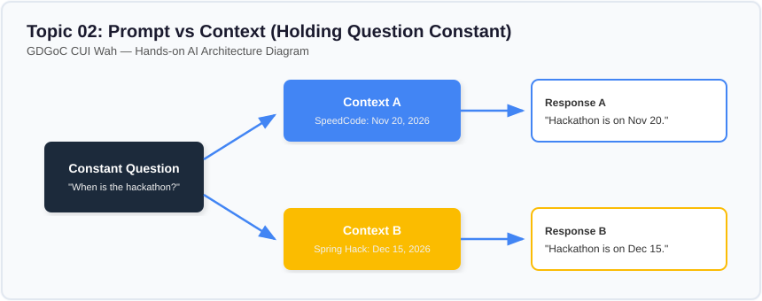

# Lesson 02: Prompt vs Context (Holding the Question Constant)

---

## 1. Learning Goal
By the end of this lesson, you will understand the dynamic relationship between prompts and context, see how keeping the user instruction constant while changing the background context alters the AI's conclusions, and learn to dissect any AI input into instructions versus data.

---

## 2. Definition in Simple English
- **The Prompt (Instruction):** The constant operator that defines the task. For example: *"Extract the fee and deadline."*
- **The Context (Data):** The variable payload containing the ground truth facts. For example: *Event Notice A* versus *Event Notice B*.

In software terms:
$$\text{AI Output} = \text{Model}(\text{Prompt Instruction}, \text{Context Payload})$$
When the prompt remains fixed and the context changes, the output shifts to reflect the new factual reality.

---

## 3. Roman Urdu Explanation
*Yeh concept samajhna bohot zaroori hai:*  
*Aap ka sawal wahi rehta hai: "Bhai hackathon ki fees aur aakhri tareeqh kya hai?" (Yeh hai Constant Prompt).*  
*Lekin agar context badal jaye:*  
- *Context 1: "SpeedCode Hackathon, fees PKR 500, aakhri date 16 November."*  
- *Context 2: "DataHack Hackathon, bilkul free entry, aakhri date 5 December."*  
*Model apna dimagh nahi lagata, balki jo context aap use dete hain, usi ke hisab se foran apna jawab badal leta hai.*  
*Iska matlab yeh hua ke agar aap chahte hain ke AI sach bole, toh sara zor **sahi context supply karne** par lagana hoga!*

---

## 4. Visual Diagram

### Concept Flowchart (Mermaid)


### Standalone Architectural Diagram


---

## 5. Campus-Based Practical Example
Suppose your **GDGoC CUI Wah** Discord bot has a slash command: `/ask-event`.
A student types: `"What is the registration fee?"`
- If the bot injects the record for **Wah SpeedCode 2026**, the response is: *"PKR 500 per team."*
- If the bot injects the record for the **Git & GitHub Workshop**, the response is: *"It is 100% free of charge."*
The user never had to rewrite their question—the context engine routed the correct information into the model!

---

## 6. Real AI Experiment
In this experiment, we execute two live API requests:
1. We hold the question constant: `"What is the registration deadline and fee for the upcoming hackathon?"`
2. We evaluate it under **Context A (SpeedCode Hackathon)** and then under **Context B (DataHack)**.  
We inspect whether Gemini strictly extracts the facts specific to each document.

---

## 7. Complete Runnable Python Code
Run this demonstration from the repository root:
```bash
python day-2-context-engineering/demos/demo_02_prompt_vs_context.py
```

```python
import sys
from pathlib import Path

REPO_ROOT = Path(__file__).resolve().parent.parent.parent
if str(REPO_ROOT) not in sys.path:
    sys.path.insert(0, str(REPO_ROOT))

from src.ai_helper import ask_gemini

user_question = "What is the registration deadline and fee for the upcoming hackathon?"

context_a = (
    "EVENT RECORD A:\n"
    "Title: Wah SpeedCode Hackathon 2026\n"
    "Fee: PKR 500 per team\n"
    "Registration Deadline: November 16, 2026\n"
    "Venue: Student Activity Center (SAC), Ground Floor, CUI Wah\n"
)

context_b = (
    "EVENT RECORD B:\n"
    "Title: CUI National DataHack 2026\n"
    "Fee: Free of cost (fully sponsored by alumni)\n"
    "Registration Deadline: December 05, 2026\n"
    "Venue: Main Auditorium, CUI Wah\n"
)

# 1. Evaluate with Context A
prompt_a = f"Using this record:\n{context_a}\nAnswer: {user_question}"
print("--- [EVALUATING CONTEXT A] ---")
print(ask_gemini(prompt_a, temperature=0.2).strip())

# 2. Evaluate with Context B
prompt_b = f"Using this record:\n{context_b}\nAnswer: {user_question}"
print("\n--- [EVALUATING CONTEXT B] ---")
print(ask_gemini(prompt_b, temperature=0.2).strip())
```

---

## 8. Illustrative Sample Output
> *Illustrative output — actual Gemini responses may vary.*

```text
--- [EVALUATING CONTEXT A] ---
For the Wah SpeedCode Hackathon 2026, the registration fee is PKR 500 per team, and the registration deadline is November 16, 2026.

--- [EVALUATING CONTEXT B] ---
For the CUI National DataHack 2026, the event is free of cost (sponsored by alumni), and the registration deadline is December 05, 2026.
```

---

## 9. What the Code Does
1. Demonstrates that modern LLMs act as context-conditioned reasoning engines.
2. Proves that changing external data does not require altering prompts or retraining models.
3. Forms the conceptual bridge to **Retrieval-Augmented Generation (RAG)**.

---

## 10. Try It Yourself
Exercise: Look at this combined input string:
```text
"You are a helpful campus assistant. Summarize the following notice in 2 bullet points:
[NOTICE: CS Lab 03 will be closed for maintenance on Monday from 9 AM to 1 PM.]"
```
Identify:
1. Which part is the **Instruction (Prompt)**?
2. Which part is the **Background Information (Context)**?

---

## 11. Reflection Question
If an AI provides an outdated answer to a student about exam dates, was it necessarily a "hallucination," or could the context provided to the model have simply been stale?
