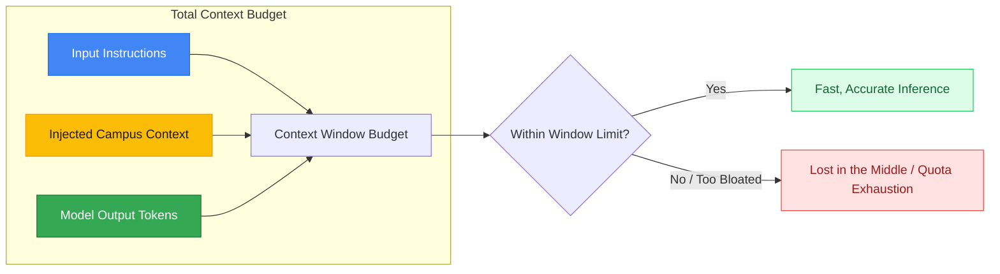

# Lesson 03: Context Window and Token Limits

---

## 1. Learning Goal
By the end of this lesson, you will understand what **tokens** are, how the **context window** functions as a finite computational budget, why 1 token does not simply equal 1 English word, and why dumping excessive, noisy text degrades response quality and exhausts API quotas.

---

## 2. Definition in Simple English
Large Language Models do not read text in letters or complete words; they process text in chunks called **tokens**.  
- A single token can represent a whole word (e.g., `" Wah"`), a subword (e.g., `" engin"`, `"eering"`), or individual punctuation marks and spaces.
- **Rule of Thumb (English):** $1 \text{ token} \approx 4 \text{ characters}$, or $\approx 0.75 \text{ words}$. So a 100-word paragraph uses roughly 130–140 tokens.
- **Context Window:** The upper limit of tokens that a model can process in a single request. This includes:
$$\text{Total Tokens} = \text{Input Prompt} + \text{Injected Context} + \text{Model Output Response}$$
If you exceed this window or cram too much unrelated text into it, processing slows down, API costs increase, and the model may experience the **"Lost in the Middle"** phenomenon where it overlooks the specific fact you need.

---

## 3. Roman Urdu Explanation
*Token ko aam lafzon mein samajhne ke liye socho:*  
*AI text ko lafz ba lafz nahi parhta, balki chote chote tukron (tokens) mein torta hai. Misal ke taur par lafz "COMSATS" shayad 2 ya 3 tokens banaye.*  
*Context Window bilkul aapke examination paper ki tarah hai: paper par likhne ki ek hadd (limit) hoti hai. Agar aap teacher se sawal puchte waqt 10 alag alag kitabein unke samne phaink dein aur bole: "In sab mein se dekh kar batao kal class kab hai"—toh teacher ka dimagh ghoom jayega!*  
*Isliye Context Engineering ka sunehri usool hai:*  
*"Model ko sirf wahi text do jo us sawal ka jawab dene ke liye zaroori ho!"*

---

## 4. Visual Diagram

### Concept Flowchart (Mermaid)


### Standalone Architectural Diagram


---

## 5. Campus-Based Practical Example
Suppose a first-semester student asks: `"When does registration close for the Python workshop?"`
- **Bloated Approach:** Your application concatenates the campus bus schedule, cafeteria renovation notice, futsal tournament rules, and library hours into the prompt alongside the workshop note.  
  *(Result: You waste 800 unnecessary tokens, and the model has to sift through noise).*
- **Lean Approach:** Your application retrieves *only* the Python workshop note (approx. 60 tokens).  
  *(Result: The model answers in 0.5 seconds with zero distraction).*

---

## 6. Real AI Experiment
In this experiment, we execute two live requests to Gemini for the exact same student question:
1. First, using a **Lean Context** (only the relevant workshop note).
2. Second, using a **Bloated Context** (embedding 5 unrelated campus notices).  
We estimate token counts and observe the outputs.

---

## 7. Complete Runnable Python Code
Run this demonstration from the repository root:
```bash
python day-2-context-engineering/demos/demo_03_context_window_and_tokens.py
```

```python
import sys
from pathlib import Path

REPO_ROOT = Path(__file__).resolve().parent.parent.parent
if str(REPO_ROOT) not in sys.path:
    sys.path.insert(0, str(REPO_ROOT))

from src.ai_helper import ask_gemini

question = "When does registration close for the Python workshop?"

# 1. Lean Context
lean_context = (
    "Title: Python for Absolute Beginners Workshop\n"
    "Date: November 05, 2026\n"
    "Registration Deadline: November 03, 2026\n"
    "Venue: CS Lab 03, Academic Block 2, CUI Wah\n"
)

# 2. Bloated Context (5 notices merged)
bloated_context = (
    "Notice 1: Cafeteria Renovation from Nov 1 to Nov 15.\n"
    "Notice 2: Futsal Cup at 3:30 PM. Fee is PKR 1000.\n"
    "Notice 3: Python for Absolute Beginners Workshop. Date: Nov 05, 2026. Deadline: Nov 03, 2026. Lab 03.\n"
    "Notice 4: Library study hall relocated to Seminar Room A.\n"
    "Notice 5: Shuttle bus departs Wah Cantt at 07:45 AM.\n"
)

print(f"Lean chars: {len(lean_context)} | Bloated chars: {len(bloated_context)}")

print("--- [EXPERIMENT 1: LEAN CONTEXT] ---")
prompt_lean = f"Context:\n{lean_context}\nQuestion: {question}\nAnswer in 1 sentence."
print(ask_gemini(prompt_lean).strip())

print("\n--- [EXPERIMENT 2: BLOATED CONTEXT] ---")
prompt_bloated = f"Context:\n{bloated_context}\nQuestion: {question}\nAnswer in 1 sentence."
print(ask_gemini(prompt_bloated).strip())
```

---

## 8. Illustrative Sample Output
> *Illustrative output — actual Gemini responses may vary.*

```text
Lean chars: 147 | Bloated chars: 326
--- [EXPERIMENT 1: LEAN CONTEXT] ---
Registration for the Python for Absolute Beginners Workshop closes on November 03, 2026.

--- [EXPERIMENT 2: BLOATED CONTEXT] ---
Registration for the Python for Absolute Beginners Workshop closes on November 03, 2026.
```

---

## 9. What the Code Does
1. Demonstrates that while modern models like Gemini 2.5 can easily handle large contexts, sending bloat wastes bandwidth and token quotas.
2. Employs the character-to-token ratio heuristic (`len(text) // 4`) as an introductory estimation tool.
3. Proves that filtering context *before* calling the model is the hallmark of professional context engineering.

---

## 10. Try It Yourself
Exercise: Suppose you have 5 campus notices:
1. `CS Lab maintenance schedule`
2. `Python workshop registration details`
3. `Cafeteria menu for Wednesday`
4. `Sports ground futsal timings`
5. `Library fine payment policy`

If a student asks: *"Do I need to pay to register for the Python workshop?"*, which notice(s) must you select, and which 4 should you filter out?

---

## 11. Reflection Question
Why is the slogan *"Just dump the whole PDF manual into the prompt"* a dangerous design pattern for real-world software applications?
