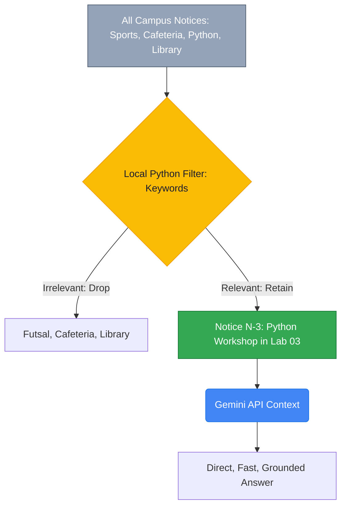
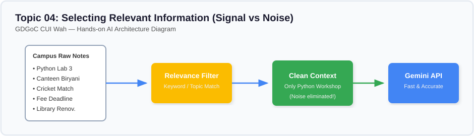

# Lesson 04: Selecting Relevant Information (Filtering Signal from Noise)

---

## 1. Learning Goal
By the end of this lesson, you will understand how to build a basic programmatic filter in Python that selects only relevant information from a campus dataset before constructing an AI prompt, and why filtering signal from noise improves accuracy and performance.

---

## 2. Definition in Simple English
In production AI engineering, your raw database might contain tens of thousands of rows—student records, campus policies, cafeteria notices, timetable revisions, and society events.  
If you pass all of this raw data to an LLM every time a user asks a question, your application will be slow, expensive, and prone to distraction.  
**Relevance Selection** is the process of using deterministic algorithms (such as keyword matching, category filters, or vector similarity) on your own local server to isolate the tiny subset of records that directly pertain to the user's inquiry, passing *only* that subset to the model.

---

## 3. Roman Urdu Explanation
*Socho CUI Wah ki library mein 50,000 kitabein hain. Agar aap library attendant se pucho: "Bhai, Python variables par koi acchi kitab do?"*  
*Agar attendant saari 50,000 kitabein utha kar aapke gale mein daal de ke "In sab ko khud parh lo"—toh aap ka kya haal hoga?*  
*Attendant pehle computer par search karta hai: "Python", aur sirf woh 2 kitabein nikal kar deta hai jo aapke kaam ki hain.*  
*Humein bhi Python code ke zariye pehle **search aur filter** karna chahiye, taake Gemini API ke paas sirf kaam ki information jaye, poora campus ka kachra nahi!*

---

## 4. Visual Diagram

### Concept Flowchart (Mermaid)


### Standalone Architectural Diagram


---

## 5. Campus-Based Practical Example
Suppose your GDGoC bot has 4 notices:
1. `N-1: Futsal Cup`
2. `N-2: Cafeteria closure`
3. `N-3: Python workshop in CS Lab 03 (Free)`
4. `N-4: Library relocation`

When a student asks: `"Where is the Python workshop happening and is there a fee?"`
- Your Python script checks keywords: `{"python", "workshop", "fee"}`.
- It finds a match in `N-3` and discards `N-1`, `N-2`, and `N-4`.
- It feeds *only* `N-3` to Gemini. The model answers instantly!

---

## 6. Real AI Experiment
In this experiment, we execute two live API requests:
1. **Unfiltered Call:** We dump all 4 notices into the prompt.
2. **Filtered Call:** We run a transparent Python function `select_relevant_notices()` to extract only `N-3`, build a lean prompt, and send it to Gemini.

---

## 7. Complete Runnable Python Code
Run this demonstration from the repository root:
```bash
python day-2-context-engineering/demos/demo_04_selecting_relevant_information.py
```

```python
import sys
from pathlib import Path

REPO_ROOT = Path(__file__).resolve().parent.parent.parent
if str(REPO_ROOT) not in sys.path:
    sys.path.insert(0, str(REPO_ROOT))

from src.ai_helper import ask_gemini

CAMPUS_NOTICES = [
    {"id": "N-1", "topic": "Sports", "text": "Futsal Cup kicks off Dec 02. Entry PKR 1,000."},
    {"id": "N-2", "topic": "Cafeteria", "text": "Cafeteria Block C is closed for renovation."},
    {"id": "N-3", "topic": "Workshops", "text": "Python for Beginners is on Nov 05 in CS Lab 03. Free entry."},
    {"id": "N-4", "topic": "Library", "text": "Library digital lab relocated to Seminar Room A."}
]

def select_relevant_notices(query: str, notices: list) -> list:
    keywords = [w.lower() for w in query.split() if len(w) > 3]
    return [n for n in notices if any(kw in (n["topic"] + " " + n["text"]).lower() for kw in keywords)]

query = "Where is the Python workshop happening and is there a fee?"

# 1. Unfiltered Call
all_ctx = "\n".join(f"[{n['id']}] {n['text']}" for n in CAMPUS_NOTICES)
prompt_all = f"Notices:\n{all_ctx}\n\nQuestion: {query}"
print("--- [EXPERIMENT 1: ALL NOTICES] ---")
print(ask_gemini(prompt_all).strip())

# 2. Filtered Call
matched = select_relevant_notices(query, CAMPUS_NOTICES)
filtered_ctx = "\n".join(f"[{n['id']}] {n['text']}" for n in matched)
prompt_filtered = f"Notices:\n{filtered_ctx}\n\nQuestion: {query}"
print("\n--- [EXPERIMENT 2: FILTERED CONTEXT] ---")
print(ask_gemini(prompt_filtered).strip())
```

---

## 8. Illustrative Sample Output
> *Illustrative output — actual Gemini responses may vary.*

```text
--- [EXPERIMENT 1: ALL NOTICES] ---
The Python for Beginners workshop will take place in CS Lab 03 on November 05, and entry is completely free for all students.

--- [EXPERIMENT 2: FILTERED CONTEXT] ---
The Python for Beginners workshop is taking place in CS Lab 03, and it is free to attend.
```

---

## 9. What the Code Does
1. Implements local, deterministic Python keyword searching to filter records *before* calling an external API.
2. Compares response content to demonstrate that filtering achieves identical accuracy while using a fraction of the prompt length.
3. Teaches students how to keep data pipelines clean and efficient.

---

## 10. Try It Yourself
Exercise: Suppose a student asks: `"Where can I find food while Block C is under repair?"`
1. Test how `select_relevant_notices` handles this query.
2. Ensure that it matches `N-2` (Cafeteria) and passes it to Gemini.
3. Run the live call and verify the answer mentions the kiosk near Block B!

---

## 11. Reflection Question
What are the limitations of simple keyword matching? What happens if a student asks: *"Where can I learn coding?"* but the notice uses the word *"programming"* instead of *"coding"*?  
*(Hint: This is why advanced RAG systems use semantic embeddings!)*
