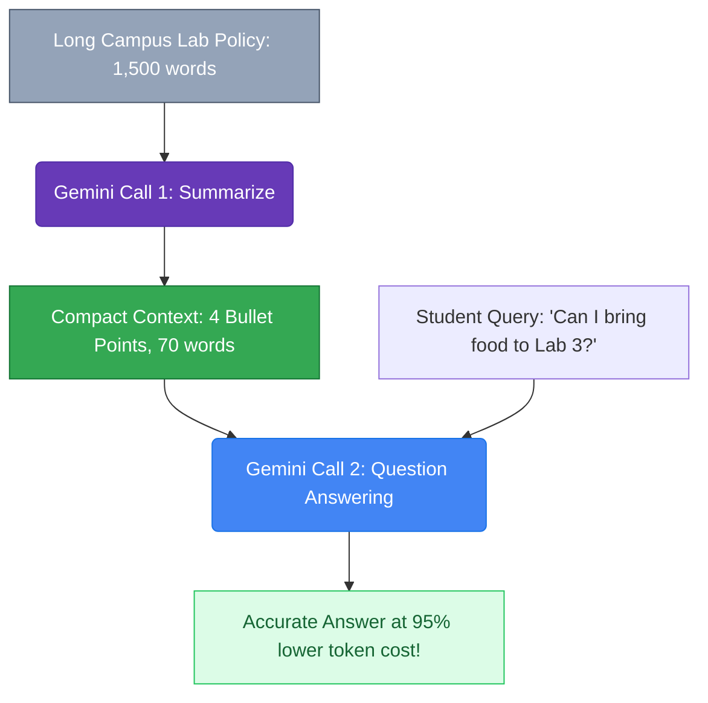

# Lesson 05: Context Compression and Summarization

---

## 1. Learning Goal
By the end of this lesson, you will understand how to compress lengthy campus documents into compact, fact-dense summaries, how to chain a summarized context into downstream question-answering calls, and how to evaluate the fundamental trade-off between token savings and information loss.

---

## 2. Definition in Simple English
**Context Compression** is the technique of converting a large, wordy document into a significantly shorter representation that retains the core factual essence required for future tasks.  
Instead of repeatedly passing a 2,000-word university policy document on every single student question:
1. **Compress once:** Ask the LLM to distill the document into a high-density, bulleted summary.
2. **Reuse often:** Feed the compact summary into subsequent user questions at a fraction of the token cost.

> [!WARNING]
> **The Information Loss Trade-Off:** Compression is inherently lossy. When you reduce text volume by 80%, minor details, exceptions, and subtle legal qualifiers may be discarded.

---

## 3. Roman Urdu Explanation
*Socho CUI Wah ka lab policy document 20 pages ka hai. Har dafa jab koi junior student puchte hain: "Bhai kya lab mein chips kha sakte hain?"—aap poori 20 pages ki PDF AI ko bhejte hain.*  
*Yeh bilkul fizool kharchi hai!*  
*Iska smart hal yeh hai ke aap pehle model se kaho: "Is 20 pages ki policy ka 4 bullets mein nichorh (summary) bana do."*  
*Ab jab bhi koi bacha sawal puche, aap woh 4 bullets ka chota summary context mein daal kar foran jawab de dete hain.*  
*Lekin yaad rahe: summary banate waqt choti moti baatein miss bhi ho sakti hain!*

---

## 4. Visual Diagram

### Concept Flowchart (Mermaid)


### Standalone Architectural Diagram


---

## 5. Campus-Based Practical Example
Suppose the computing department releases a lengthy **Computing Lab Policy 2026** covering ID cards, bag storage, food rules, USB scans, and evening gate passes.
- By running a one-time compression pipeline, you distill the document into 4 key operational rules.
- When an attendee asks: *"Can I bring my backpack and lunch inside?"*, the summarized context provides the immediate answer: *"No food is permitted; backpacks must remain on entrance racks."*

---

## 6. Real AI Experiment
In this experiment, we execute two real API calls:
1. **Model Call 1:** Gemini processes the full lab policy and returns a compact 4-bullet summary.
2. **Model Call 2:** Gemini uses that exact returned summary as context to answer a student's practical question about food and backpacks.

---

## 7. Complete Runnable Python Code
Run this demonstration from the repository root:
```bash
python day-2-context-engineering/demos/demo_05_context_compression_and_summarization.py
```

```python
import sys
from pathlib import Path

REPO_ROOT = Path(__file__).resolve().parent.parent.parent
if str(REPO_ROOT) not in sys.path:
    sys.path.insert(0, str(REPO_ROOT))

from src.ai_helper import ask_gemini

long_policy = (
    "COMSATS WAH COMPUTING LAB POLICY 2026: "
    "1. All students entering CS Labs 01-06 must display university ID cards. Bags must be placed on wooden storage racks near the door. "
    "2. Absolutely no food items (chips, biscuits) are permitted near terminals. Sealed water bottles allowed on floor only. "
    "3. Unauthorized software or cracked IDEs strictly prohibited. USBs must be virus-scanned. "
    "4. For hackathons past 5:00 PM, an approved gate pass signed 24h prior is mandatory."
)

# Step 1: Compress long policy
print("--- [CALL 1: COMPRESSING LONG POLICY] ---")
sum_prompt = f"Condense this lab policy into 4 concise bullet points:\n{long_policy}"
summary = ask_gemini(sum_prompt)
print(summary.strip())

# Step 2: Answer question using generated summary
print("\n--- [CALL 2: ANSWERING VIA SUMMARY] ---")
question = "Can I bring my backpack and lunch into CS Lab 03 during the workshop?"
qa_prompt = f"Context:\n{summary}\n\nQuestion: {question}"
print(ask_gemini(qa_prompt).strip())
```

---

## 8. Illustrative Sample Output
> *Illustrative output — actual Gemini responses may vary.*

```text
--- [CALL 1: COMPRESSING LONG POLICY] ---
• Must wear university student ID card; backpacks must be stored on entrance racks.
• No food allowed near computers; sealed water bottles permitted on the floor only.
• Unofficial software and cracked IDEs forbidden; USB drives must be scanned.
• Evening events past 5:00 PM require a departmental gate pass approved 24 hours prior.

--- [CALL 2: ANSWERING VIA SUMMARY] ---
No. According to the lab policy, food is strictly prohibited near computer terminals, and backpacks must be placed on the storage racks near the entrance doors rather than brought to your desk.
```

---

## 9. What the Code Does
1. Chains two distinct AI operations: document distillation followed by question answering.
2. Calculates the reduction in character and token volume, illustrating that high-level queries can be serviced without retaining repetitive boilerplate.
3. Teaches students how context preprocessing reduces operational cloud costs.

---

## 10. Try It Yourself
Exercise: Suppose you are compressing a university exam postponement notice. Which of the following facts **must never be dropped** during compression?
1. The greeting and polite signature from the Registrar.
2. The original exam date and the rescheduled exam date.
3. The specific departments and degree programs affected.
4. The font family used on the university letterhead.

---

## 11. Reflection Question
If you compress a 50-page course syllabus into 1 page, what kinds of questions might the AI fail to answer correctly? How can you decide when compression is safe versus risky?
