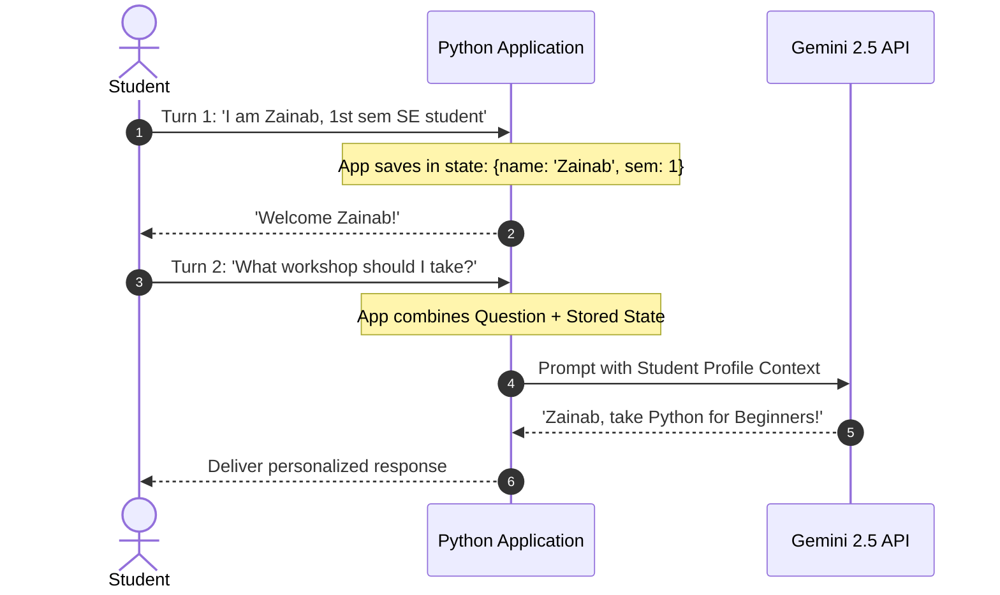
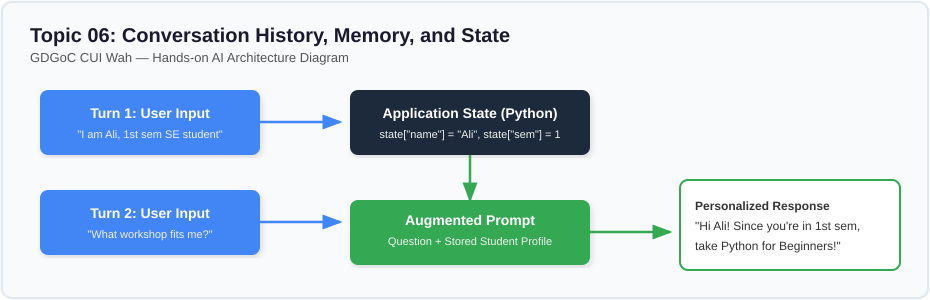

# Lesson 06: Conversation History, Memory, and Application State

---

## 1. Learning Goal
By the end of this lesson, you will understand how AI models handle multi-turn conversations, why Large Language Models are technically **stateless HTTP endpoints**, and how software developers use **application memory and state management** in Python to create personalized, multi-turn AI experiences.

---

## 2. Definition in Simple English
- **Stateless Model:** Modern LLMs do not "remember" past interactions. When you call the Gemini API, it has zero memory of what you asked 10 seconds ago. Each API call is an independent mathematical event.
- **Conversation History:** The raw sequential log of user messages and assistant replies.
- **Application State & Memory:** The deliberate variables, dictionaries, or databases maintained by your Python program (outside the model) to remember crucial facts about a user—such as their name, degree program, and preferences—and re-inject them into subsequent prompts.

---

## 3. Roman Urdu Explanation
*Boht se bache yeh samajhte hain ke AI ke paas apna dimagh hai jo baatein yaad rakhta hai. Haqeeqat yeh hai ke AI model bilkul ek **ghoray (blank slate)** ki tarah hai!*  
*Jab aap API ko call karte hain, woh purani har baat bhool chuka hota hai.*  
*Toh ChatGPT ya GDGoC bot ko kaise yaad rehta hai ke aap ka naam Zainab hai?*  
*Asal mein aapka **Python program** apne paas ek variable ya dictionary mein likh kar rakhta hai: `user["name"] = "Zainab"`. Phir jab aap agla sawal puchte hain, toh Python chupke se prompt ke andar purani baatein dobara likh kar AI ko bhejta hai.*  
*Is cheez ko **Application Memory / State Management** kehte hain!*

---

## 4. Visual Diagram

### Concept Flowchart (Mermaid)


### Standalone Architectural Diagram


---

## 5. Campus-Based Practical Example
Suppose Zainab chats with the GDGoC campus advisor:
- **Turn 1:** *"Hi, I am Zainab, a 1st-semester SE fresher with zero coding experience."*  
  *(Your Python script saves: `name="Zainab"`, `semester=1`, `level="Beginner"`).*
- **Turn 2:** *"What workshop should I join?"*  
  - If your app is **stateless** and sends only Turn 2, Gemini might recommend an advanced Cloud Kubernetes workshop!
  - If your app injects Zainab's stored state, Gemini says: *"Hi Zainab! Since you are in your 1st semester with no coding background, the Python for Absolute Beginners workshop in Lab 03 is perfect for you."*

---

## 6. Real AI Experiment
In this experiment, we execute two calls:
1. First, we send Turn 2 in isolation (without state).
2. Second, we inject the student profile dictionary from Python application memory into Turn 2's prompt.  
We compare how state awareness transforms a generic reply into a personalized recommendation.

---

## 7. Complete Runnable Python Code
Run this demonstration from the repository root:
```bash
python day-2-context-engineering/demos/demo_06_conversation_history_and_memory.py
```

```python
import sys
from pathlib import Path

REPO_ROOT = Path(__file__).resolve().parent.parent.parent
if str(REPO_ROOT) not in sys.path:
    sys.path.insert(0, str(REPO_ROOT))

from src.ai_helper import ask_gemini

# Application state stored locally in Python
app_state = {
    "name": "Zainab",
    "major": "Software Engineering",
    "semester": 1,
    "level": "Absolute Beginner"
}

turn_2_query = "What campus workshop should I register for first?"

# 1. Stateless Call (No memory)
print("--- [EXPERIMENT 1: STATELESS CALL] ---")
print(ask_gemini(turn_2_query)[:300] + "...")

# 2. Stateful Call (Application memory injected into context)
context = (
    f"Student Profile:\n"
    f"- Name: {app_state['name']}\n"
    f"- Major: {app_state['major']} (Semester {app_state['semester']})\n"
    f"- Level: {app_state['level']}\n\n"
    f"Workshops: [Python for Beginners, Cloud Kubernetes, Advanced C++]\n"
    f"Question: {turn_2_query}"
)
print("\n--- [EXPERIMENT 2: STATEFUL CALL WITH APPLICATION MEMORY] ---")
print(ask_gemini(context).strip())
```

---

## 8. Illustrative Sample Output
> *Illustrative output — actual Gemini responses may vary.*

```text
--- [EXPERIMENT 1: STATELESS CALL] ---
Choosing a workshop depends on your interests. You could explore web development, data science, mobile apps, or cloud computing. Consider starting with whatever aligns with your career goals.

--- [EXPERIMENT 2: STATEFUL CALL WITH APPLICATION MEMORY] ---
Hi Zainab! Welcome to Software Engineering at CUI Wah. 

As a first-semester student with no prior coding experience, you should definitely register for the **Python for Absolute Beginners** workshop first. It is designed specifically for freshers to build confidence in logic and basic syntax before you tackle more complex courses. Avoid Advanced C++ or Cloud Kubernetes until later semesters!
```

---

## 9. What the Code Does
1. Demonstrates that conversational continuity is created by developer code, not by AI autonomy.
2. Manages application state in a simple Python dictionary that persists across function calls.
3. Augments the runtime prompt with structured profile metadata.

---

## 10. Try It Yourself
Exercise: Add a new key to `app_state`:
`"preferred_language": "Roman Urdu"`  
Modify the prompt so that Gemini answers Zainab's workshop query in friendly Roman Urdu!

---

## 11. Reflection Question
If you have a conversation that lasts 50 messages, what will happen if you blindly append all 50 past messages into every new prompt? How can you combine **Topic 5 (Summarization)** with **Topic 6 (Memory)** to keep costs low?
