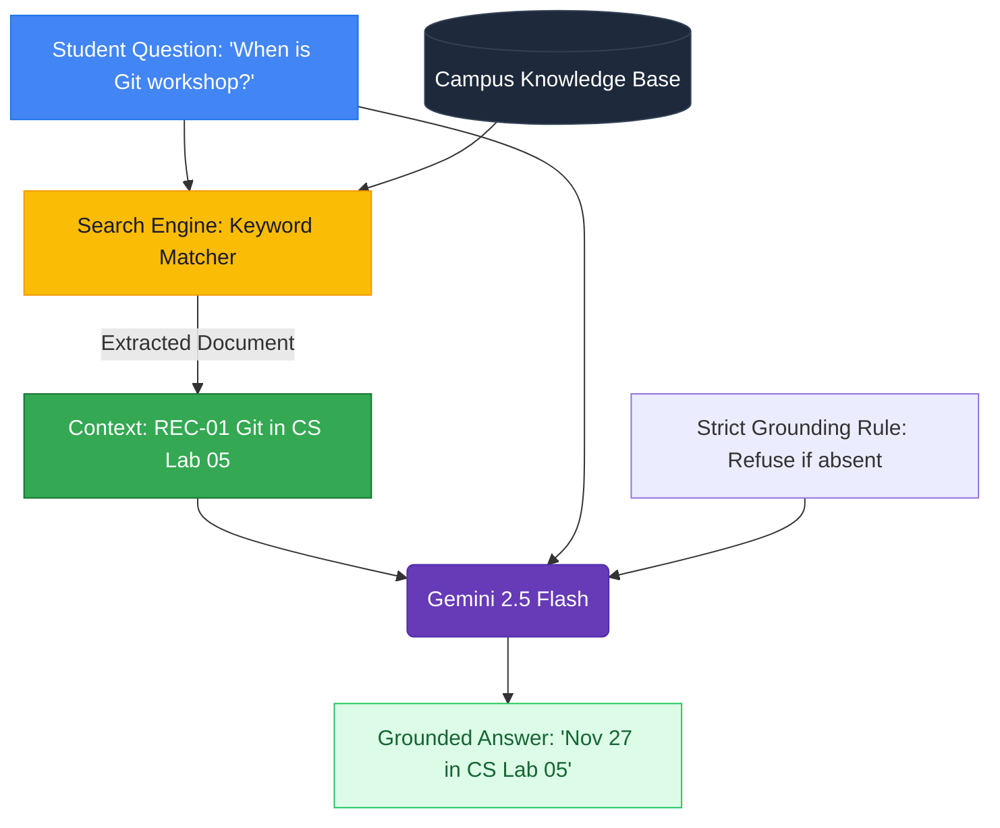

# Lesson 07: Long Context vs Retrieval-Augmented Generation (RAG)

---

## 1. Learning Goal
By the end of this lesson, you will master the principles of **Retrieval-Augmented Generation (RAG)**, understand why sending all documents in a giant prompt is inferior to targeted retrieval, and build a working mini-RAG system that gracefully refuses to hallucinate when facts are absent.

---

## 2. Definition in Simple English
**RAG (Retrieval-Augmented Generation)** is an architecture where an AI application:
1. **Retrieves:** Queries a private database or collection of documents using search (keywords or vector similarity) to find only the chunks relevant to the user's question.
2. **Augments:** Packages those retrieved chunks into the prompt context alongside a strict grounding directive (*"Answer ONLY from these documents; if missing, state that it is unavailable"*).
3. **Generates:** Invokes the LLM to synthesize a natural-language answer grounded in the verified evidence.

Why not just dump everything into a model with a 1-million-token window?  
Because retrieval keeps latency low, cuts API costs, prevents context dilution, and makes source attribution crystal clear.

> [!NOTE]
> Our demo uses beginner-friendly Python keyword matching. Production RAG typically employs **vector embeddings**, **vector databases** (e.g., Chroma, Qdrant), and **rerankers** to match semantic meaning rather than exact spellings.

---

## 3. Roman Urdu Explanation
*RAG ka concept bohot pyara aur simple hai:*  
*Socho aap open-book exam de rahe hain. Teacher ne poori library aapke samne rakh di. Agar aap har sawal ke liye saari 10 kitabein shuru se aakhir tak parhne baith jayein, toh exam ka time khatam ho jayega!*  
*Aap kya karte hain? Pehle book ke index ya table of contents mein ja kar dekhte hain ke "Page 45 par Git ka topic hai." Sirf Page 45 kholte hain aur wahan se dekh kar paper par jawab likh dete hain.*  
*Yeh 3 steps hi RAG hain:*  
1. **Retrieve:** Search kar ke sahi page nikalna.  
2. **Augment:** Us page ko samne rakhna.  
3. **Generate:** Us page ki roshni mein jawab likhna.  
*Aur agar kitab mein swimming pool ka zikr hi na ho, toh andaza lagane ke bajaye bolna: "Yeh maloomat kitab mein mojood nahi hai!"*

---

## 4. Visual Diagram

### Concept Flowchart (Mermaid)


### Standalone Architectural Diagram


---

## 5. Campus-Based Practical Example
Suppose your **GDGoC CUI Wah** Discord bot has a campus FAQ database.
- **Query 1:** `"When is the Git workshop and which lab is it in?"`  
  - *Retrieval:* Finds `REC-01 (Git Essentials)`.  
  - *Generation:* Answers: `"Friday, Nov 27 at 2:00 PM in CS Lab 05."`
- **Query 2:** `"What time does the campus swimming pool open on weekends?"`  
  - *Retrieval:* Finds 0 matching records.  
  - *Generation:* Answers: `"Information unavailable in verified campus records."`  
  *(Notice: The assistant does not invent an imaginary swimming pool schedule!)*

---

## 6. Real AI Experiment
In this experiment, we test both query types live against Gemini:
1. One answerable query that matches verified notes.
2. One query regarding non-existent campus facilities (swimming pool) to verify that strict grounding prevents hallucinations.

---

## 7. Complete Runnable Python Code
Run this demonstration from the repository root:
```bash
python day-2-context-engineering/demos/demo_07_rag_and_grounding.py
```

```python
import sys
from pathlib import Path

REPO_ROOT = Path(__file__).resolve().parent.parent.parent
if str(REPO_ROOT) not in sys.path:
    sys.path.insert(0, str(REPO_ROOT))

from src.ai_helper import ask_gemini

CAMPUS_RECORDS = [
    {"id": "REC-01", "title": "Git Workshop", "content": "Git workshop is on Friday, Nov 27 at 2:00 PM in CS Lab 05, CUI Wah."},
    {"id": "REC-02", "title": "SpeedCode Hackathon", "content": "SpeedCode hackathon is on Nov 20 in the SAC. Fee is PKR 500."},
    {"id": "REC-03", "title": "Python Workshop", "content": "Python logic building workshop is on Nov 05 in CS Lab 03."}
]

def mini_retrieve(query: str, records: list) -> list:
    terms = [t.lower() for t in query.split() if len(t) > 3]
    return [r for r in records if any(t in (r["title"] + " " + r["content"]).lower() for t in terms)]

def ask_rag(question: str):
    matched = mini_retrieve(question, CAMPUS_RECORDS)
    ctx = "\n".join(f"[{m['id']}] {m['content']}" for m in matched) if matched else "[No records found]"
    prompt = (
        "Answer ONLY using the Context Records below. If not found, say 'Information unavailable'.\n\n"
        f"Context:\n{ctx}\n\nQuestion: {question}"
    )
    return ask_gemini(prompt, temperature=0.1)

print("--- [QUERY 1: ANSWERABLE] ---")
print(ask_rag("When is the Git workshop and which lab is it in?").strip())

print("\n--- [QUERY 2: UNANSWERABLE] ---")
print(ask_rag("What time does the swimming pool open on weekends?").strip())
```

---

## 8. Illustrative Sample Output
> *Illustrative output — actual Gemini responses may vary.*

```text
--- [QUERY 1: ANSWERABLE] ---
The Git workshop is on Friday, November 27 at 2:00 PM in CS Lab 05, CUI Wah.

--- [QUERY 2: UNANSWERABLE] ---
Information unavailable. The provided records do not contain details regarding a swimming pool or weekend pool hours.
```

---

## 9. What the Code Does
1. Demonstrates the complete 3-step RAG cycle: retrieval, context augmentation, and grounded synthesis.
2. Sets a low temperature (`0.1`) to ensure strict adherence to evidence.
3. Tests both a positive hit and an out-of-distribution miss to prove the absence of hallucination.

---

## 10. Try It Yourself
Exercise: Add a fourth record to `CAMPUS_RECORDS`:
```python
{
    "id": "REC-04",
    "title": "Robotics Club",
    "content": "Robotics orientation meets in Electrical Lab 02 on Dec 10 at 11 AM."
}
```
Ask: `"When does the Robotics club meet?"` and confirm that your retrieval function captures `REC-04` and Gemini answers accurately!

---

## 11. Reflection Question
Why is keyword retrieval alone fragile when dealing with synonyms like *"seminar"* vs *"workshop"* or *"price"* vs *"fee"*? How do vector embeddings solve this problem?
