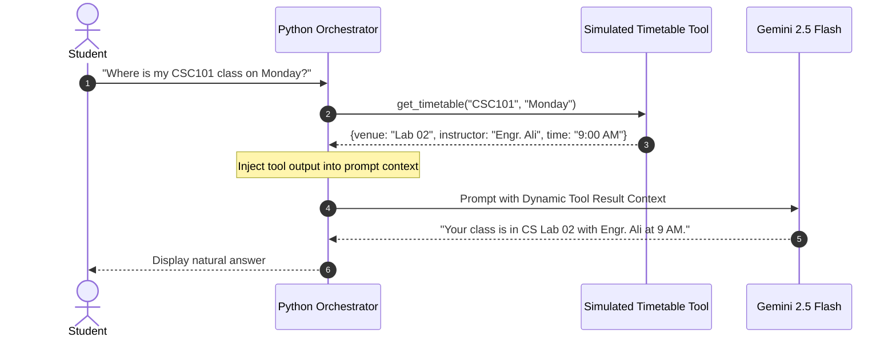

# Lesson 08: Context from Tools and External Information

---

## 1. Learning Goal
By the end of this lesson, you will understand how local Python functions and external APIs act as **Tools** that supply dynamic real-time context to an LLM, and how combining programmatic tool execution with AI reasoning enables intelligent campus assistant workflows.

---

## 2. Definition in Simple English
A foundation model like Gemini is frozen in time; it does not automatically possess real-time information such as today's room changes, live weather, or current student attendance records.  
**Tool-Augmented Context** is a design pattern where:
1. Your application recognizes that a user's question requires live external data.
2. Your Python program executes a dedicated function (a *Tool*)—such as querying an SQL database, calling a weather API, or reading a JSON file.
3. Python takes the tool's raw output (e.g., a dictionary or list) and injects it into the LLM's prompt context.
4. The LLM translates the raw data into a polite, natural-language response.

> [!NOTE]
> In our laboratory exercise, we use a clearly labeled **simulated campus timetable tool** written in Python. It does not connect to private university production databases.

---

## 3. Roman Urdu Explanation
*Socho aap kisi student se puchte hain: "Bhai, is waqt CS Lab 02 mein kis teacher ki class chal rahi hai?"*  
*Aam banda apne dimagh se andaza nahi laga sakta. Woh pehle apni jeb se mobile nikal kar **CUOnline portal ya timetable app** kholta hai, screen par dekhta hai, aur phir aapko bolta hai: "Bhai, Sir Ali ki Programming Fundamentals ki class hai."*  
*Yahan par timetable app asal mein ek **Tool** hai.*  
*AI model bhi bilkul aise hi kaam karta hai: Python ka code timetable tool chala kar data lata hai, aur Gemini us data ko dekh kar pyari si conversational English/Urdu mein student ko samjha deta hai!*

---

## 4. Visual Diagram

### Concept Flowchart (Mermaid)


### Standalone Architectural Diagram


---

## 5. Campus-Based Practical Example
Suppose a 1st-semester BCS student rushes into Academic Block 2 at 8:55 AM on a Monday morning and asks your WhatsApp bot:  
`"What room is my CSC101 class in right now, and who is the instructor?"`
- Your Python code calls: `get_simulated_campus_timetable("CSC101", "Monday")`.
- The tool returns: `{"venue": "CS Lab 02", "instructor": "Engr. Muhammad Ali", "time": "09:00 AM - 10:30 AM"}`.
- Gemini receives this dictionary as context and replies:  
  *"Good morning! Your Programming Fundamentals (CSC101) class is starting at 9:00 AM in CS Lab 02 (Academic Block 2) with Engr. Muhammad Ali. Hurry, class starts in 5 minutes!"*

---

## 6. Real AI Experiment
In this experiment:
1. We execute a local simulated Python tool `get_simulated_campus_timetable("CSC101", "Monday")`.
2. We display the raw Python dictionary returned by the tool.
3. We inject that raw dictionary into a prompt sent to Google Gemini.
4. Gemini converts the structured dictionary into a clear, natural student announcement.

---

## 7. Complete Runnable Python Code
Run this demonstration from the repository root:
```bash
python day-2-context-engineering/demos/demo_08_tools_and_external_context.py
```

```python
import sys
from pathlib import Path

REPO_ROOT = Path(__file__).resolve().parent.parent.parent
if str(REPO_ROOT) not in sys.path:
    sys.path.insert(0, str(REPO_ROOT))

from src.ai_helper import ask_gemini

# Simulated Local Tool
def get_simulated_campus_timetable(course_code: str, day: str) -> dict:
    data = {
        ("CSC101", "Monday"): {
            "course": "Programming Fundamentals",
            "time": "09:00 AM - 10:30 AM",
            "venue": "Academic Block 2, CS Lab 02",
            "instructor": "Engr. Muhammad Ali"
        }
    }
    return data.get((course_code, day), {"error": "Not found"})

query = "What room is my CSC101 class in this Monday morning, and who is teaching it?"

# 1. Python executes the tool
tool_output = get_simulated_campus_timetable("CSC101", "Monday")
print(f"Tool Result: {tool_output}")

# 2. Inject into Gemini context
prompt = (
    "You are the CUI Wah Student Academic Bot.\n"
    f"Timetable System Live Result: {tool_output}\n\n"
    f"Student Query: {query}\n"
    "Answer in a friendly, conversational tone."
)

print("\n--- [GEMINI RESPONSE (TOOL AUGMENTED)] ---")
print(ask_gemini(prompt).strip())
```

---

## 8. Illustrative Sample Output
> *Illustrative output — actual Gemini responses may vary.*

```text
Tool Result: {'course': 'Programming Fundamentals', 'time': '09:00 AM - 10:30 AM', 'venue': 'Academic Block 2, CS Lab 02', 'instructor': 'Engr. Muhammad Ali'}

--- [GEMINI RESPONSE (TOOL AUGMENTED)] ---
Your Programming Fundamentals (CSC101) lecture this Monday morning is scheduled from 09:00 AM to 10:30 AM in CS Lab 02, located in Academic Block 2. The course instructor is Engr. Muhammad Ali.
```

---

## 9. What the Code Does
1. Separates factual retrieval (executed deterministically by Python code) from natural language generation (performed by Gemini).
2. Illustrates the architecture behind modern **AI Agents** and Function Calling.
3. Demonstrates that an LLM does not need direct database access if an application wraps data into the context window.

---

## 10. Try It Yourself
Exercise: Create a second simulated tool:
```python
def get_workshop_room_status(room_name: str) -> dict:
    # Returns {"room": "CS Lab 05", "capacity": 45, "projector_working": True}
```
Call this tool in Python, pass its return value into Gemini, and ask: *"Is CS Lab 05 ready for the Git workshop presentation?"*

---

## 11. Reflection Question
Why is executing a local Python tool to check database facts safer than allowing an AI model to run arbitrary SQL queries directly on your university server?
