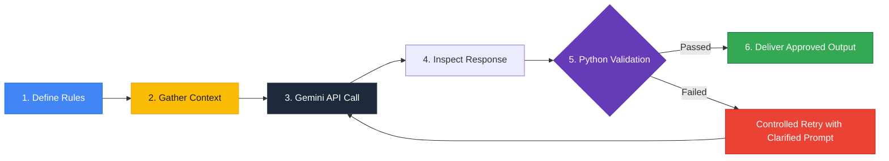
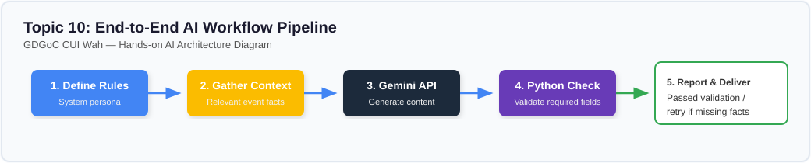

# Lesson 10: A Basic AI Workflow (The Production Pipeline)

---

## 1. Learning Goal
By the end of this lesson, you will understand how to construct a complete, robust **AI Engineering Workflow Pipeline**, connecting instructions, context gathering, live model invocation, programmatic response inspection, and deterministic validation with controlled retry logic.

---

## 2. Definition in Simple English
A **Basic AI Workflow** is a structured, end-to-end software pipeline that treats the Large Language Model not as a final product, but as one reasoning component inside an automated system.  
A complete production pipeline consists of 6 sequential stages:
1. **Define Instructions:** Set system personas, constraints, and operational bounds.
2. **Gather & Select Context:** Query local databases and filter verified factual records.
3. **Execute Model Call:** Transmit the structured prompt to the Gemini API.
4. **Inspect Response:** Clean and prepare the output string.
5. **Deterministic Validation:** Use non-AI Python logic (e.g., regex, keyword checks, JSON schema validators) to verify required fields.
6. **Report or Retry:** If validation passes, deliver the result; if it fails, report the error or trigger a controlled retry.

---

## 3. Roman Urdu Explanation
*Real-world software development mein aap sirf prompt likh kar haath par haath rakh kar nahi baithte. Ek poori **Factory Pipeline (Workflow)** banai jaati hai:*  
1. *Pehle rules set karo: "Hum GDGoC ke liye post bana rahe hain."*  
2. *Campus dataset se event ke verified facts uthao (Date, Venue, Fee).*  
3. *Gemini API ko call karo.*  
4. *Model ka jawab wapis aane par usko check karo.*  
5. **Python Verification (Sab se ahem!):** *Python code se check karo: kya model ne venue (CS Lab 03) aur date (Nov 05) shamil ki hai? Kya text 100 alfaaz se chota hai?*  
6. *Agar pass ho gaya toh WhatsApp group mein publish karo; agar koi zaroori cheez miss ho gayi toh dobara theek karao!*  
*Is tarah aapka system kabhi crash nahi hota aur hamesha verified data deliver karta hai.*

---

## 4. Visual Diagram

### Concept Flowchart (Mermaid)


### Standalone Architectural Diagram


---

## 5. Campus-Based Practical Example
Suppose GDGoC CUI Wah deploys an automated broadcast bot.
The bot must guarantee that **no post is ever published** to the official 500-student WhatsApp community unless it explicitly includes:
1. The workshop name
2. The specific lab venue
3. The exact date
4. Free registration status
By putting deterministic Python checks at Stage 5, even if Gemini occasionally forgets to include the venue, your script intercepts the defect and fixes it before any student sees an incomplete announcement!

---

## 6. Real AI Experiment
In this experiment, we execute the complete 6-stage pipeline:
1. We load a verified record for the **Python for Beginners Workshop** from our campus data.
2. We call Gemini with system rules and event context.
3. We run a deterministic dictionary check verifying `title_present`, `venue_present`, `date_present`, and `length_ok`.
4. We display the final validated announcement and diagnostic report.

---

## 7. Complete Runnable Python Code
Run this demonstration from the repository root:
```bash
python day-2-context-engineering/demos/demo_10_basic_ai_workflow.py
```

```python
import sys
from pathlib import Path

REPO_ROOT = Path(__file__).resolve().parent.parent.parent
if str(REPO_ROOT) not in sys.path:
    sys.path.insert(0, str(REPO_ROOT))

from src.ai_helper import ask_gemini

# Stage 1 & 2: Rules and Context
event_data = {
    "title": "Python for Beginners",
    "date": "November 05, 2026",
    "venue": "CS Lab 03, CUI Wah",
    "fee": "Free"
}

system_rules = "You are a campus event assistant. Write a short WhatsApp broadcast. Must include Title, Date, and Venue."
context = f"Title: {event_data['title']} | Date: {event_data['date']} | Venue: {event_data['venue']} | Fee: {event_data['fee']}"
prompt = f"Context: {context}\nDraft the broadcast."

# Stage 3: Call Model
response = ask_gemini(prompt, system_instruction=system_rules, temperature=0.3)

# Stage 4 & 5: Inspect and Deterministically Validate
checks = {
    "venue_included": "lab 03" in response.lower() or "cui wah" in response.lower(),
    "date_included": "november" in response.lower() or "nov" in response.lower(),
    "length_valid": len(response.split()) <= 100
}

# Stage 6: Report
print(f"Validation Report: {checks}")
if all(checks.values()):
    print("\n--- [DELIVERABLE APPROVED] ---")
    print(response.strip())
else:
    print("\n[VALIDATION FAILED] Re-routing to retry...")
```

---

## 8. Illustrative Sample Output
> *Illustrative output — actual Gemini responses may vary.*

```text
Validation Report: {'venue_included': True, 'date_included': True, 'length_valid': True}

--- [DELIVERABLE APPROVED] ---
🚀 Start Your Coding Journey with GDGoC CUI Wah! 💻

Join us for the "Python for Beginners" workshop and learn how to build your first scripts from scratch!

📅 Date: November 05, 2026
📍 Venue: CS Lab 03, Academic Block 2, CUI Wah
🎟️ Fee: 100% Free!

Don't miss out—bring your laptop and kickstart your coding skills. Register today! 🔗
```

---

## 9. What the Code Does
1. Encapsulates the entire AI lifecycle inside a robust, testable Python function.
2. Treats model text as an intermediate candidate output subject to rigorous programmatic inspection.
3. Establishes the bridge between basic scripting and professional AI engineering.

---

## 10. Try It Yourself
Exercise: Add a fifth validation rule to `checks`:
`"has_registration_link": "http" in response.lower() or "link" in response.lower()`  
Run the pipeline and observe if your script alerts you when an announcement omits a registration link!

---

## 11. Reflection Question
Why is combining deterministic Python code with probabilistic AI models better than relying on an AI model to evaluate its own output?
